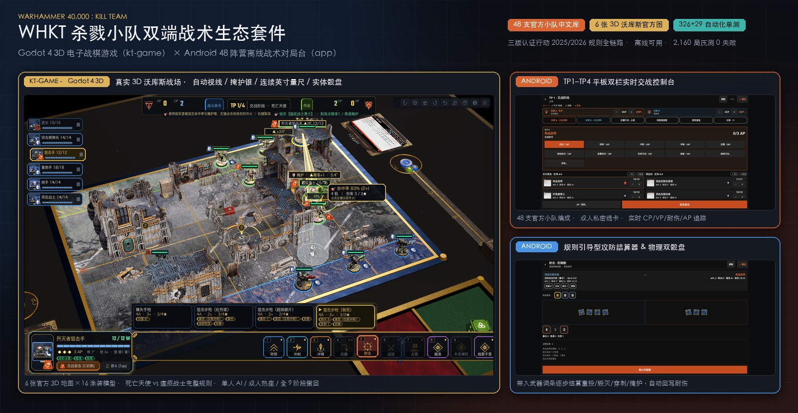
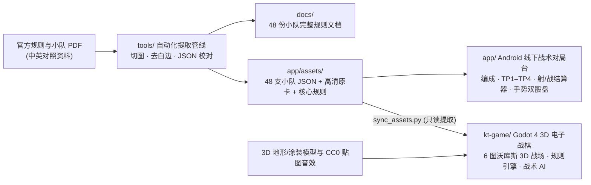
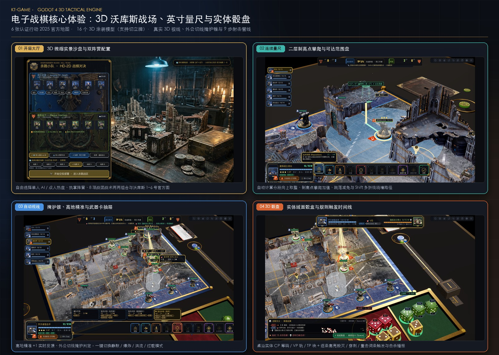
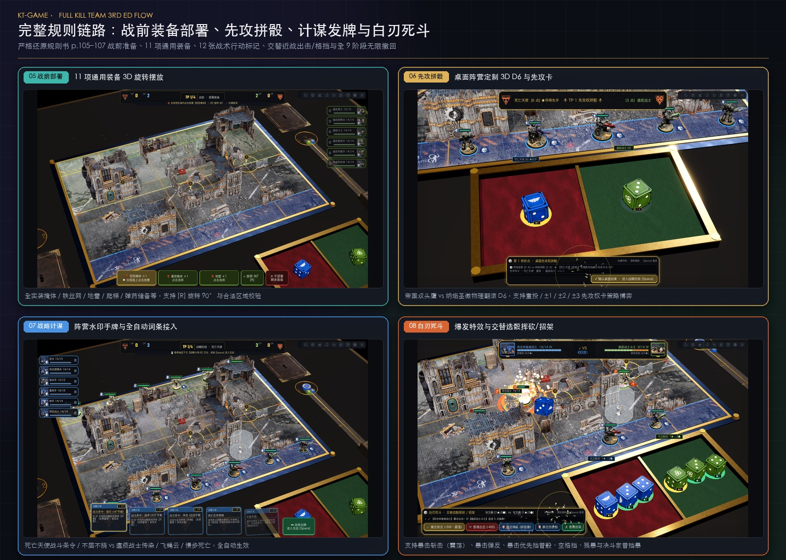
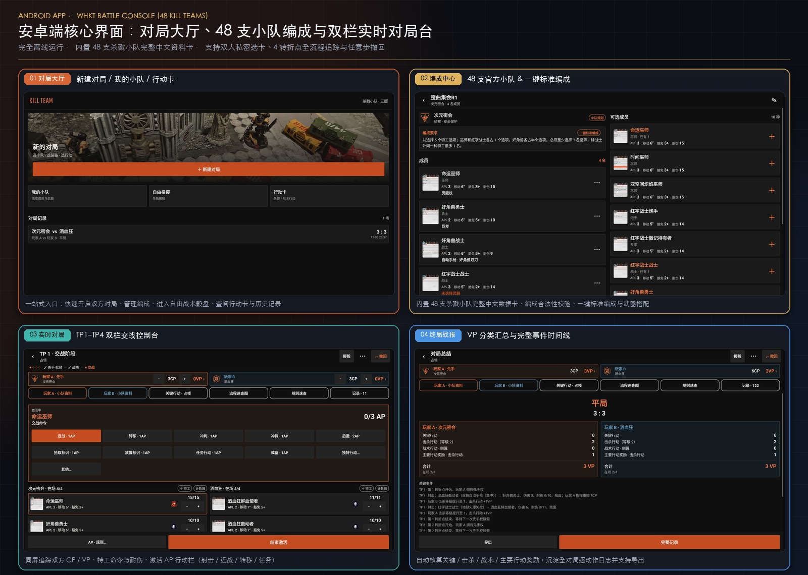
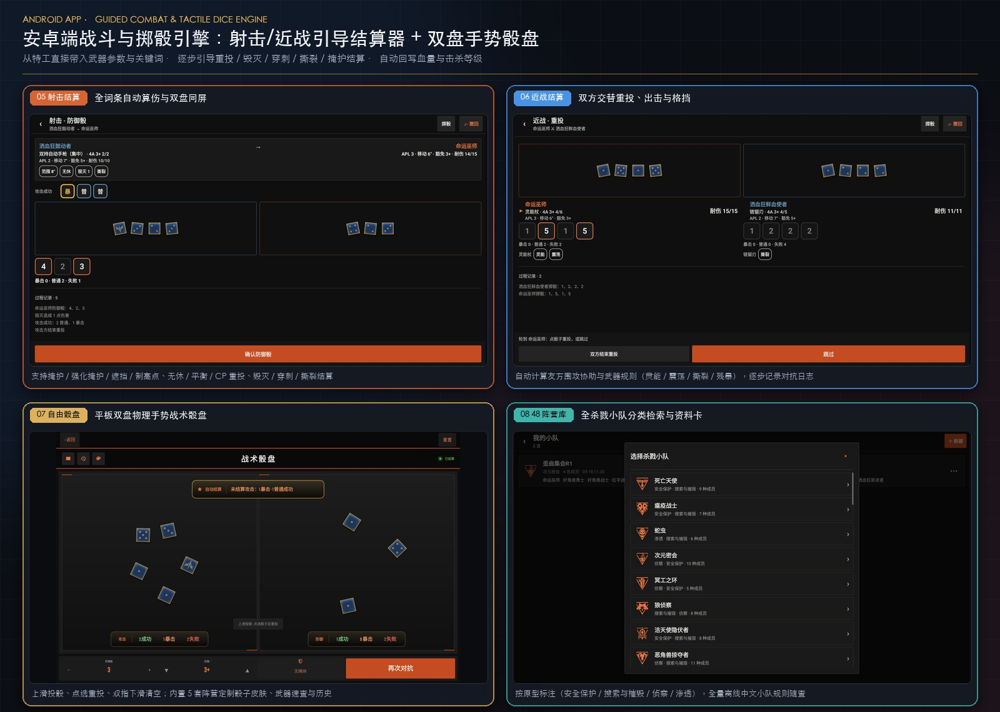

# WHKT · 战锤 40,000：杀戮小队双端战术套件

<p align="center">
  <strong>一套面向《杀戮小队（三版 · 认证行动 2025/2026）》的全链路战术生态项目</strong><br>
  包含 <strong>Godot 4 3D 电子战棋游戏（<code>kt-game/</code>）</strong>、<strong>Android 48 阵营离线线下对局控制台（<code>app/</code>）</strong><br>
  以及覆盖 <strong>48 支官方杀戮小队</strong> 的结构化中文规则数据库与自动化提取管线（<code>tools/</code> · <code>docs/</code>）
</p>

<p align="center">
  <a href="README.md">简体中文</a> · <a href="README_EN.md">English</a> · <a href="kt-game/README.md">KT-Game 专题文档</a>
</p>

<p align="center">
  
  
  
  
  
  
</p>

<p align="center">
  
</p>

<p align="center">
  <a href="#-项目全景与架构">项目全景</a> ·
  <a href="#-一kt-game--godot-4-3d-电子战棋游戏">KT-Game 3D 战棋</a> ·
  <a href="#-二app--whkt-battle-consoleandroid-线下战术控制台">Android 对局台</a> ·
  <a href="#-三规则数据管线与文档库tools--docs">数据管线与 48 阵营库</a> ·
  <a href="#-快速开始与开发构建">快速开始</a> ·
  <a href="#-仓库目录结构">目录结构</a>
</p>

---

## 🗺️ 项目全景与架构

本仓库围绕《杀戮小队（Kill Team）》三版官方规则（认证行动 2025 / 2026 勘误），沉淀为 **三大互不侵入、数据共享的核心模块**：

| 模块 | 目录 | 技术栈 | 定位与核心价值 | 当前体量 / 验证状态 |
| :--- | :--- | :--- | :--- | :--- |
| **3D 电子战棋游戏** | [`kt-game/`](kt-game/README.md) | Godot 4 + GDScript (Forward+ 3D) | 独立可玩的完整桌游电子化版本：真实 3D 沃库斯地形与涂装模型、连续英寸几何、3D 视线/掩护锥、全自动攻防规则与单人战术 AI / 双人热座 | 21 源码文件 (21,186 行) · 6 官方图 · **326 项单测 PASS** · **2,160 局全规则压测 0 失败** |
| **Android 线下对局台** | `app/` | Kotlin + Android SDK 34（离线优先） | 面向实体桌面战棋玩家的平板/手机全流程助手：48 支小队完整中文资料卡、4 步战前设置、TP1–TP4 双栏控制台、引导式射击/近战结算器、物理双盘手势骰盘 | 55 Kotlin 源码 · **48 支完整小队中文库** · 29 组 JUnit 规则单测 · 平板/手机双端适配 |
| **规则与资产管线** | `tools/` · `scripts/` · `docs/` | Python + Ruby + Shell | 官方中英 PDF 自动抓取、原卡切图去白边、武器图标提取、48 支小队 JSON 校对生成、TTS 3D 沃库斯地图规则矩形拟合、量尺 SVG 生成 | 32 个管线脚本 · 48 份小队完整规则文档 · 规则词典 & 审计报告 |



---

## 🎯 一、`kt-game/` — Godot 4 3D 电子战棋游戏

> 详见专题文档：[`kt-game/README.md`](kt-game/README.md) · 一键启动：`./kt-game/run.sh`

`kt-game/` 是一款完全独立的桌面战棋电子化引擎，采用 **暗黑哥特 HD-2D / 3D 桌面沙盘美学**，把实体桌面的地形、涂装棋子、绒面骰盒、黄铜 CP 筹码堆、VP 计分轨与数据卡垫一比一搬上屏幕，并由严格的核心规则引擎驱动全流程自动裁决。

<p align="center">
  
</p>

<p align="center">
  
</p>

### 核心玩法与规则实现

- **杀戮区·沃库斯 6 张官方 3D 地图（`30" × 22"`）**
  - 内置认证行动 2025 全部 6 张官方地图（`volkus_25_01` – `volkus_25_06`），地图 1–3 为东西短边 `6"` 降落区、地图 4–6 为南北长边 `3"` 降落区；真实 3D 堡垒与大小废墟模型（`assets/terrain/volkus/`）与规则碰撞矩形逐图数值拟合校准。
  - **16 个特工 3D 涂装模型**（`assets/minis/`）并支持在 ⚙ 设置中一键切换为 **亚克力立牌 token**；受击后仰、阵亡翻倒留下骷髅标记，且撤回时 3D 状态实时同步。
- **全 3D 连续英寸几何与视线/掩护求解（`kt_geometry.gd`）**
  - 移动（转移 / 冲刺 / 冲锋 / 后撤 / 与掩体移动）实时绘制带 `1"` 刻度的英寸量尺与可达范围盘；严格实现 **每段路径独立向上取整**、**攀爬按高度向上取整**、**跳落忽略前 `2"`**、**冲刺禁止攀爬**、**Shift 多折线绕墙**、**反击总移动上限 `2"`**、**重型武器移动锁** 与 **铁丝网/爬梯** 修正。
  - 全面采用 **3D 垂直距离与眼高/模型高视线判定**（可见性、控制范围、外公切线掩护锥、飞蝇云、传染、排毒口、监控/追踪敌军、震荡手雷、近战支援）。
- **完整 9 步射击管线 + 多目标链式结算 + 交替近战博弈（`kt_combat.gd`）**
  - **远程射击**：精准、平衡、无休、毁灭、致命、穿刺、关键穿刺、毒素、重击、撕裂（严格隔离保底转化骰）、饱和、寻轻、严重、静默、晕眩、剧毒、过热；完整支持 **爆炸（Blast）与洪流（Torrent）多目标次要目标链式结算**（洪流支持提前结束，多目标仅在末尾检定 1 次过热并联动慈父赐福）；支持 **制高点/隐匿 `2普 ↔ 1暴` 切换** 与 **迷彩斗篷 + 隐匿双掩护（`1暴 + 1普`）**。
  - **近战白刃死斗**：双方同时掷骰后交替【出击 / 格挡】，支持 **暴击优先挡普骰**、**对手 0 成功骰空格挡（p.18）**、**残暴限制**、**决斗家普挡暴**、**震荡碎骰** 与 **暴击保留即触发晕眩**。
- **死亡天使（IMP-AOD）vs 瘟疫战士（CHAOS-PM）深度阵营还原**
  - **死亡天使**：9 种特工编队、8 项战团战术两两自由组合、阿斯塔特双射/双战与跨命令反击、3 种战斗条令、他们无所畏惧、不屈不挠、超人体格、震慑突袭、复仇之怒、纯洁印章、战团圣物（0CP 复仇之怒）、偏移肩盾（2026 勘误掷后按需触发）、占卜仪、钢铁光环、狙击手瞄准镜。
  - **瘟疫战士**：7 种特工编队、纳垢毒素、恼人韧性 `4+`、传染、慢步死亡、飞蝇云、纳垢灵、致命毒素、恶心韧性、腐烂诅咒（攻/防骰锁死 `3` 点且不可重掷/保留）、瘟疫之钟、疫病手雷、瘟疫弹药、排毒口、腐蚀连枷横扫、有毒瘴气、腐烂活力、慈父赐福。
  - *注：阵营 24 张核心策略/装备卡已实装交互 21 张；剩余 3 张边缘策略卡（灵活战术 / 调整条令 / 剧毒破灭）与军士「战团老兵」可在原卡灯箱中查阅。*
- **完整战前流程、11 项通用装备与 12 张战术行动（p.105–107）**
  - `战前拼骰 → 选降落区（互换/重投先手卡）→ 秘密选特工 → 秘密选装备 → 秘密选战术行动 → 轮流部署装备（可旋转/跳过）→ 按 1/3 轮流部署特工 → TP1–TP4（先手卡 ±1/±2/±3/重投 → 战略与主任务 → 交战）→ 终局结算`。
  - 11 项通用装备（弹药储备 / 铁丝网 / 通讯装置 / 地雷 / 轻型掩体 / 重型掩体 / 爬梯 / 可移动掩体 / 烟雾与震荡手雷 / 破片与穿甲手雷 / 破拆炸药）与 12 张战术行动全部实装上桌。
- **单人 AI / 双人热座隐私幕布 / 无限撤回 / 悬停规则词典**
  - 84 条可交互规则词条（`KTRuleChip` / `KTRulePopover`，悬停简述、点击固定原文、`ESC` 不穿透）；支持单人执掌任一方对抗战术 AI（含拐角绕墙与连枷调度）或双人热座；`Z` / `↶` 覆盖全部 9 阶段及骰盘内逐字节安全撤回。
  - **质量验证**：`326 / 326` 单元测试通过 + `10,643` 模糊不变量校验 + `2,160` 局全规则全流程完整 4 TP 压测（含 12 局实盘 GUI、1,043,929 次不变量校验与 6,792 次全阶段实盘 Undo 续跑）**0 失败、0 警告**。

<details>
<summary>⌨️ KT-Game 常用快捷键一览（点击展开）</summary>

| 快捷键 | 功能说明 |
| :---: | :--- |
| `Space` | 确认当前步骤 / 推进阶段 / 确认热座隐私幕布 / 骰盘主操作按钮 |
| `Z` | 撤回上一步（支持全部 9 阶段与交战骰盘内撤回） |
| `Shift + 左键` | 移动模式下添加折线拐点绕过重型废墟墙体 |
| `R` | 战前装备部署模式下将掩体 / 铁丝网旋转 90° |
| `C` | 特工激活后尚未行动前切换【隐匿 / 交战】命令 |
| `Tab` | 调阅当前活跃特工的高清中文数据卡灯箱 |
| `F` | 重置 3D 战场镜头为默认等距战术视角 |
| `F1` / `F2` | 随时翻阅死亡天使 / 瘟疫战士完整阵营规则与计谋原卡库 |
| `ESC` | 关闭规则气泡 / 原卡灯箱 / 设置弹窗，或取消当前移动/瞄准模式 |

</details>

---

## 📱 二、`app/` — WHKT Battle Console（Android 线下战术控制台）

**WHKT Battle Console** 是一款专为实体桌面战棋对局打造的 **全离线 Android 战术控制台与攻防骰盘**（适配横屏平板与竖屏手机），彻底替代纸笔记录与频繁翻书查表。

<p align="center">
  
</p>

<p align="center">
  
</p>

### 核心功能模块

1. **48 支官方杀戮小队完整中文资料库 & 智能编成（`RosterListActivity` / `RosterActivity`）**
   - 离线内置 **全部 48 支官方杀戮小队** 结构化 JSON 数据、高清中文数据卡与计谋规则书（详见下方折叠名录）。
   - 支持按小队规则实时校验编成合法性、**一键标准编成**、单名特工武器自由搭配，以及无限套自定义小队本地持久化复用。
2. **4 步战前设置向导 & 双人私密选卡交接（`BattleSetupActivity` / `SecretSelection.kt`）**
   - 按三版官方流程依次完成：`1 选择双方小队 → 2 选择双方装备（最多 4 项）→ 3 选择关键行动（占领 / 掠夺 / 传输情报 / 宝球 / 宣告主权 / 能量电池 / 下载等）→ 4 双人独立私密选择战术行动（附回避提示幕布）与战前部署先手`。
3. **TP1–TP4 双栏实时对局台（`BattleActivity`）**
   - 顶部阶段进度条清晰展示 `TP 1–4` 与 `先手·就绪 ─ 战略 ─ 交战` 当前步骤，实时维护双方 **CP、关键/击杀/战术/主要行动 VP** 与击杀等级。
   - 双栏并排呈现双方在场特工，支持一键切换 **隐匿/交战命令指示物**、**就绪/待机**、快速增减耐伤、挂接状态标记、自定义计数器、阵营计谋面板，并一键打开 **小队资料 / 关键行动 / 流程速查图 / 规则速查 / 完整对局记录**。
   - 激活特工后展开完整 **AP 行动栏**（射击 / 近战 / 转移 / 冲刺 / 冲锋 / 后撤 / 拾取 / 放置 / 任务行动 / 戒备 / 独特行动），任意误操作支持 **↶ 撤回**。
4. **规则引导型射击 & 近战结算器（`ShootingCombatActivity` / `MeleeCombatActivity`）**
   - **射击结算器**：直接带入攻击方武器属性与词条（`范围 / 无休 / 平衡 / 精准 / 毁灭 / 穿刺 / 关键穿刺 / 撕裂 / 严重 / 重击 / 致命 / 过热`等），引导配置掩护 / 强化掩护 / 遮挡 / 制高点，逐步完成攻骰投掷、重投、可选规则应用、防骰投掷与自动算伤，并将最终伤害、残废与击杀等级 **一键回写至对局台**。
   - **近战结算器**：双栏选择攻防双方近战武器与友方围攻协助，支持双方掷骰、重投以及逐枚成功骰交替 **出击 / 格挡**，完整记录对抗过程日志。
5. **物理手势双盘战术骰盘（`MainActivity` / `DiceTrayView.kt`）**
   - 独立自由掷骰入口，平板端红铜攻击盘与冷钢防御盘同屏对照，手机端左右滑动无缝切换且历史盘只读防误触。
   - **手势优先**：上滑投骰、点选骰子后上滑重投、双指下滑清空；配合物理碰撞动画与同步滚动音效。
   - **5 套阵营定制骰子皮肤**：死亡天使、瘟疫战士、兽人特战队、虚空海盗、克里格兵团；内置全量武器词条速查与本地投掷历史恢复。

<details>
<summary>📋 Android 端内置 48 支官方杀戮小队完整中文名录（点击展开）</summary>

| 序号 | 编号 | 小队中文名 | 序号 | 编号 | 小队中文名 | 序号 | 编号 | 小队中文名 |
| :---: | :--- | :--- | :---: | :--- | :--- | :---: | :--- | :--- |
| 1 | `IMP-AOD` | 死亡天使 | 17 | `KT-EXODITE_DRAGON_MASTERS` | 流亡驭龙师 | 33 | `KT-NEMESIS_CLAW` | 复仇之爪 |
| 2 | `CHAOS-PM` | 瘟疫战士 | 18 | `KT-FARSTALKER_KINBAND` | 远猎者族团 | 34 | `KT-NOVITIATES` | 见习修女 |
| 3 | `CHAOS-WC` | 次元密会 | 19 | `KT-GELLERPOX_INFECTED` | 盖勒痘魔 | 35 | `KT-PATHFINDERS` | 探路者 |
| 4 | `CHAOS-FELL` | 恶角兽掠夺者 | 20 | `KT-GOREMONGERS` | 洒血狂 | 36 | `KT-PHOBOS_STRIKE_TEAM` | 恐惧突袭小队 |
| 5 | `IMP-CI` | 洁天使隐伏者 | 21 | `KT-HAND_OF_THE_ARCHON` | 执政官之手 | 37 | `KT-RATLINGS` | 莱特林 |
| 6 | `IMP-WS` | 狼侦察 | 22 | `KT-HEARTHKYN_SALVAGERS` | 炉心打捞者 | 38 | `KT-SANCTIFIERS` | 净化者 |
| 7 | `NEC-CAN` | 冥工之环 | 23 | `KT-HERNKYN_YAEGRIS` | 远行者猎手 | 39 | `KT-SCOUT_SQUAD` | 侦查小队 |
| 8 | `TYR-RAV` | 蛇虫 | 24 | `KT-HIEROTEK_CIRCLE` | 神圣技师之环 | 40 | `KT-SPECTRE_SQUAD` | 魅影小队 |
| 9 | `WYRM` | 虫刃 | 25 | `KT-HUNTER_CLADE` | 猎手支队 | 41 | `KT-TEMPESTUS_AQUILONS` | 风暴飞鹰 |
| 10 | `KT-BATTLECLADE` | 战斗支队 | 26 | `KT-IMPERIAL_NAVY_BREACHERS` | 帝国海军跳帮者 | 42 | `KT-VESPID_STINGWINGS` | 胡蜂尖翼 |
| 11 | `KT-BLADES_OF_KHAINE` | 凯恩之刃 | 27 | `KT-INQUISITORIAL_AGENTS` | 审判厅特勤 | 43 | `KT-VOID_DANCER_TROUPE` | 虚空舞者剧团 |
| 12 | `KT-BLOODED` | 浴血者 | 28 | `KT-KASRKIN` | 卡舍津 | 44 | `KT-WRECKA_KREW` | 破坏专队 |
| 13 | `KT-BROOD_BROTHERS` | 族群裔兵 | 29 | `KT-KOMMANDOS` | 特种兵 | 45 | `KT-XV26_STEALTH_BATTLESUITS` | XV26 隐形战斗服 |
| 14 | `KT-CHAOS_CULT` | 混沌教派 | 30 | `KT-LEGIONARIES` | 军团 | 46 | `KT-DEATHWATCH` | 死亡守望 |
| 15 | `KT-CORSAIR_VOIDSCARRED` | 虚空创痕海盗 | 31 | `KT-MANDRAKES` | 曼德拉 | 47 | `KT-DEATH_KORPS` | 死亡军团 |
| 16 | `KT-EXACTION_SQUAD` | 强征小队 | 32 | `KT-MURDERWING` | 屠戮之翼 | 48 | `KT-ELUCIDIAN_STARSTRIDERS` | 艾露西亚星行者 |

</details>

| 自由骰盘操作 | 手机端 | 平板端 |
| :--- | :--- | :--- |
| 投掷当前骰子 | 在当前骰盘上滑 | 在当前阶段骰盘上滑 |
| 选骰与重投 | 点选骰子后上滑重投 | 点选骰子后上滑重投 |
| 清空当前结果 | 双指下滑 | 双指下滑 |
| 对照攻防双方 | 攻击确认后左右滑动查看 | 攻击盘与防御盘始终同屏 |

---

## 🛠️ 三、规则数据管线与文档库（`tools/` · `scripts/` · `docs/`）

仓库配套了一整套可复现的数据工程与质量保障工具链：

- **官方规则抓取与卡图切分（`tools/`）**：
  - `download_kill_team_rules.py`、`batch_kill_team_pipeline.py`、`extract_kill_team_cards.py`、`detect_card_frames.py`、`remove_card_white_border.sh`：自动从规则 PDF 检测卡框、裁切数据卡/计谋卡并去除白边。
  - `extract_core_rules.py`、`extract_team_mark.py`、`extract_weapon_icons.py`、`import_prepared_teams.py`、`check_team_data.py`、`check_team_rules.py`、`verify_team_extract.py`：生成并校验 `app/src/main/assets/` 下的 `core_rules.json` 与 48 支小队 JSON / 徽记 / 规则条目。
- **3D 地图与词典生成（`kt-game/tools/`）**：
  - `sync_assets.py`：从 `app/` 只读提取 JSON、原卡与头像，并自动生成亚克力立牌资源（支持 `--all` 同步全 48 支小队）。
  - `build_volkus_map.py`：从 TTS 沃库斯官方布局与地形 OBJ 切分规则碰撞矩形（Heavy / Vantage / Light），生成 `kt-game/data/maps/volkus_25_01..06.json`。
  - `build_glossary.py`：汇总生成 84 条结构化规则词典 `kt-game/data/core/glossary.json`。
- **实体量尺工具与完整资料库（`scripts/` & `docs/`）**：
  - `scripts/create_kill_team_gauges.py`：生成并校验杀戮小队 `1"/2"/3"/6"` 物理量尺模板。
  - `docs/`：沉淀 48 份完整中文小队规则资料（`*-完整规则资料.md`）、《规则引导型 APP 优化方案》、《捉对对战测试方法与进度报告》与《代码审计报告》。

---

## 🚀 快速开始与开发构建

### 1. 运行 KT-Game（Godot 4 3D 电子战棋）

需要 **Godot 4.3+**（已在 macOS Apple Silicon + Godot 4.7.2 Metal Forward+ 完整验证）：

```bash
# 一键检测资源并启动 3D 电子战棋
./kt-game/run.sh

# 运行无头核心规则与 UI 单元测试（326 项断言）
/opt/homebrew/bin/godot --headless --path kt-game -s res://tests/run_all.gd

# 运行六图 AI 对 AI 全流程压力测试
/opt/homebrew/bin/godot --headless --path kt-game -s res://tests/scenario_playtest.gd -- --seeds=20 --all-tacs

# 运行实盘 3D GUI 自动对局验收
/opt/homebrew/bin/godot --headless --path kt-game res://scenes/Main.tscn -- --playtest-ui --map=volkus_25_02 --mode=ai --side=A

# 重新生成全部 14 张全流程高清 3D 截图（输出至 kt-game/build/screenshots/）
/opt/homebrew/bin/godot --path kt-game -- --autotest-screenshots
```

### 2. 构建与测试 Android 线下对局台（`app/`）

需要 **Android 7.0+（API 24）** 设备或模拟器；源码构建需 **JDK 17** 与 **Android SDK 34**：

```bash
git clone https://github.com/digitalghost/WHKT-dice.git
cd WHKT-dice

# 编译 Debug APK（输出至 app/build/outputs/apk/debug/app-debug.apk）
./gradlew :app:assembleDebug

# 安装到已连接的真机或模拟器
adb install -r app/build/outputs/apk/debug/app-debug.apk

# 运行全部 29 组 Kotlin JUnit 规则测试与 Android Lint 检查
./gradlew :app:testDebugUnitTest :app:lintDebug
```

---

## 📂 仓库目录结构

```text
WHKT-dice/
├── README.md                              # 仓库全景中文说明（本文件）
├── README_EN.md                           # 英文说明
├── kt-game/                               # 【子项目一】Godot 4 3D 电子战棋游戏（独立零侵入）
│   ├── README.md                          # KT-Game 详细专题文档
│   ├── run.sh                             # 一键启动脚本
│   ├── scenes/Main.tscn                   # 主场景入口
│   ├── data/                              # 核心规则、通用装备、战术行动、84 条词典、6 张沃库斯地图、双阵营 JSON
│   ├── assets/                            # 沃库斯 3D 地形、16 个 3D 涂装模型、CC0 PBR 贴图与音效
│   ├── src/
│   │   ├── core/                          # kt_engine / kt_combat / kt_geometry / kt_ai / kt_data / kt_glossary / kt_settings
│   │   ├── board/                         # killzone_view / kt_models_3d / kt_table_props_3d / kt_vfx_3d / kt_dice_3d
│   │   └── ui/                            # main_game / dice_combat_modal / card_lightbox / kt_rule_chip / kt_rule_popover / kt_sfx / kt_ui_playtest
│   ├── tools/                             # sync_assets.py / build_volkus_map.py / build_glossary.py
│   └── tests/                             # run_all.gd（326 项断言）与 scenario_playtest.gd
├── app/                                   # 【子项目二】Android 48 阵营线下战术对局台（Kotlin）
│   └── src/
│       ├── main/
│       │   ├── assets/                    # core_rules.json + 48 支官方小队 JSON/规则卡/任务图
│       │   ├── java/com/example/helloworld/
│       │   │   ├── BattleHubActivity.kt   # 对局中心、继续对局与历史战报
│       │   │   ├── BattleSetupActivity.kt # 4 步战前设置向导与私密选卡
│       │   │   ├── BattleActivity.kt      # TP1–TP4 双栏实时对局台、CP/VP/命令/血量/计谋
│       │   │   ├── ShootingCombatActivity.kt / ShootingCombatRules.kt  # 规则引导型射击结算器
│       │   │   ├── MeleeCombatActivity.kt / MeleeCombatRules.kt        # 近战交替出击/格挡结算器
│       │   │   ├── MainActivity.kt / DiceTrayView.kt / RollLogic.kt    # 双盘物理手势战术骰盘
│       │   │   ├── RosterListActivity.kt / RosterActivity.kt           # 48 支小队编成与数据卡
│       │   │   └── RuleGlossary.kt / TeamRuleBook.kt / MissionCards.kt # 离线规则书与行动卡速查
│       │   └── res/                       # 手机与 sw600dp 平板双端自适应布局与素材
│       └── test/                          # 29 组 JUnit 单元测试（规则流、射/战结算、全小队模拟与审计回归）
├── tools/                                 # 官方 PDF 抓取、切图去白边、图标提取与 JSON 校验管线（32 个脚本）
├── scripts/                               # 物理量尺 SVG 生成与校验脚本
└── docs/                                  # 48 份小队中文规则资料、设计文档、审计报告与 README 视觉展示图
    └── images/                            # 全新实机捕获并精修的 Hero Banner 与双端功能预览图
```

---

## 🤝 参与贡献、免责声明与许可证

- **欢迎贡献**：欢迎提交 Issue / PR！适合优先参与的方向包括：为 `kt-game/` 扩展更多阵营（`sync_assets.py --all` 已打通全部 48 支小队资产提取）、补齐 `kt-game/` 剩余 3 张边缘阵营策略卡交互、为 `app/` 补充多语言本地化与屏幕阅读器优化等。提交前请分别运行 `./gradlew :app:testDebugUnitTest :app:lintDebug` 与 `godot --headless --path kt-game -s res://tests/run_all.gd`。
- **免责声明**：本项目是由战棋玩家制作的非官方开源工具与电子原型，与 Games Workshop 无任何隶属、赞助或认可关系。“Warhammer 40,000”“Kill Team”及相关名称、徽记与素材归各自权利人所有。`docs/` 中的规则提取仅供持有正版规则书时的本地学习与开发检索，始终请以官方最新规则为准。
- **开源许可**：项目源码以 [Apache License 2.0](LICENSE) 发布；字体与 CC0 贴图/音效许可详见 [`docs/licenses`](docs/licenses)、`kt-game/assets/textures/LICENSE.md` 与 `kt-game/assets/audio/LICENSE.md`。

---

<p align="center">如果这个项目让你的《杀戮小队》线上推演或线下桌游对局更顺畅，欢迎点一颗 ⭐ Star！</p>
