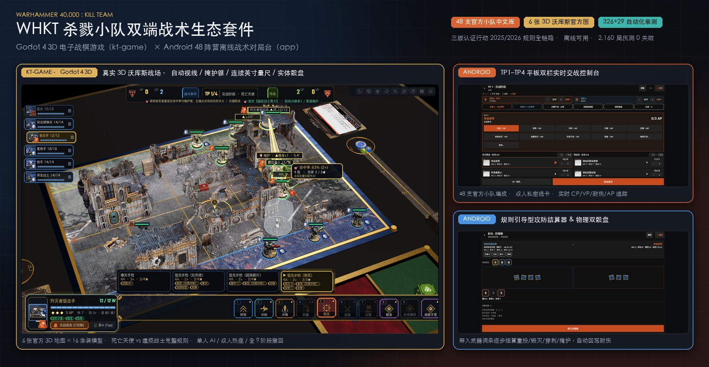
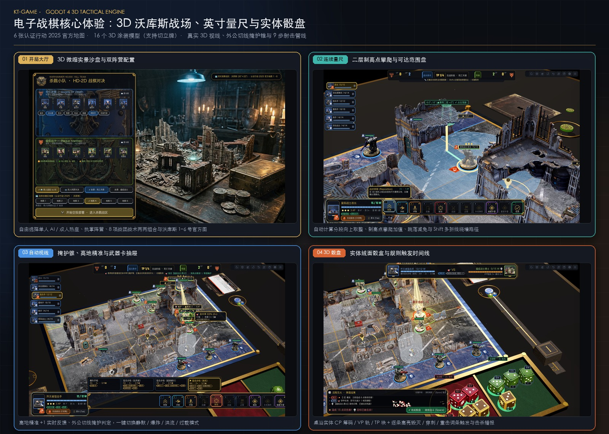
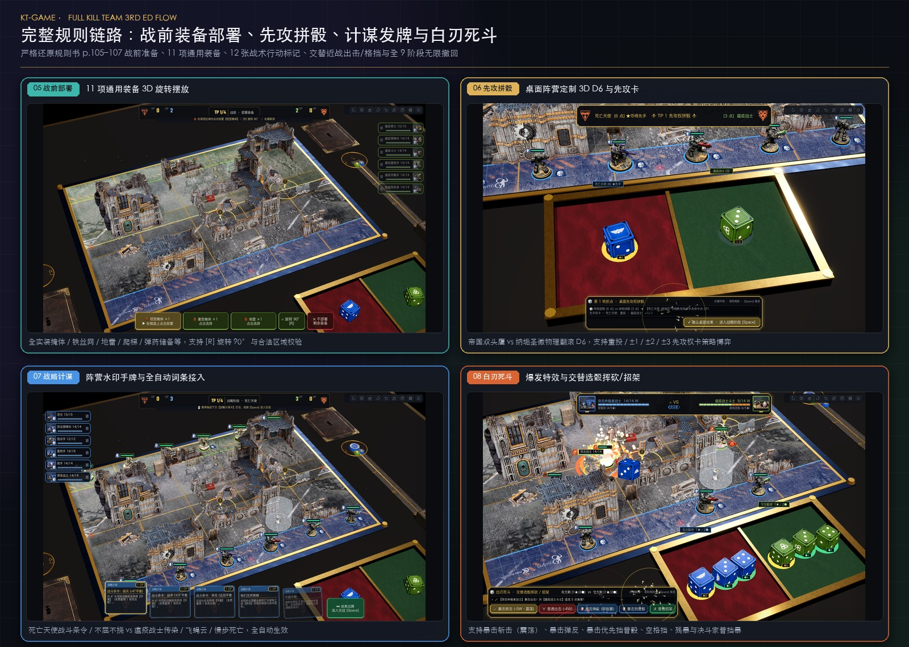
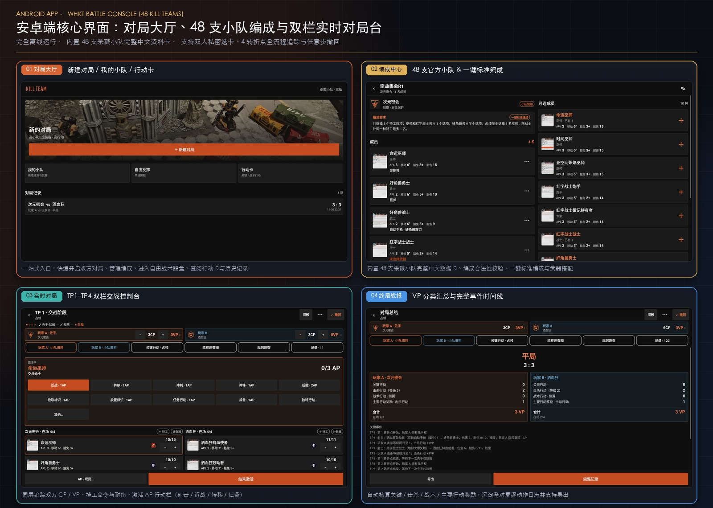
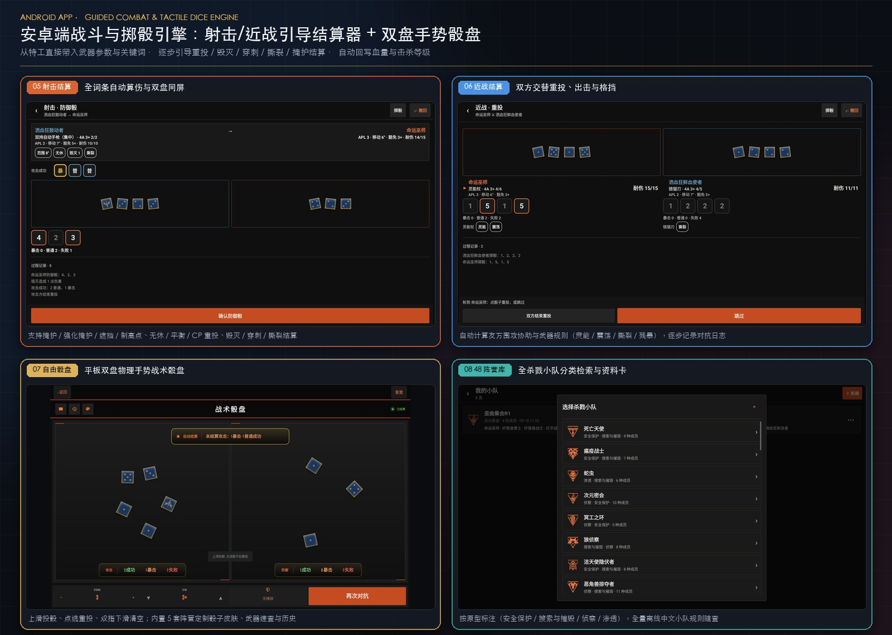

# WHKT · Warhammer 40,000: Kill Team Dual-Platform Tactical Suite

<p align="center">
  <strong>A complete 3rd-Edition Kill Team (Approved Ops 2025/2026) tactical ecosystem</strong><br>
  combining a standalone <strong>Godot 4 3D Tabletop Game (<code>kt-game/</code>)</strong>, an offline <strong>Android 48-Team Battle Console (<code>app/</code>)</strong>,<br>
  and an automated <strong>48-Kill-Team Structured Rules & Asset Pipeline (<code>tools/</code> · <code>docs/</code>)</strong>.
</p>

<p align="center">
  <a href="README.md">简体中文</a> · <a href="README_EN.md">English</a> · <a href="kt-game/README.md">KT-Game Docs (ZH)</a>
</p>

<p align="center">
  
  
  
  
  
  
</p>

<p align="center">
  
</p>

---

## Ecosystem Overview

| Module | Directory | Stack | Purpose | Scale & Verification |
| :--- | :--- | :--- | :--- | :--- |
| **3D Tabletop Game** | [`kt-game/`](kt-game/README.md) | Godot 4 + GDScript (Forward+ 3D) | Playable digital Kill Team boardgame with real 3D Volkus terrain, painted 3D minis, continuous inch rulers, 3D LoS/cover cones, automated combat engine, tactical AI & hotseat | 21 source files (21,186 LOC) · 6 official maps · **326 unit tests PASS** · **2,160 full-coverage matches, 0 failures** |
| **Android Battle Console** | `app/` | Kotlin + Android SDK 34 (Offline-first) | Tablet & phone companion for physical tabletop play: 48-team Chinese rules & roster builder, 4-step setup wizard, TP1–TP4 live console, guided shooting/melee resolvers, dual-tray gesture dice roller | 55 Kotlin files · **48 complete Kill Teams** · 29 JUnit test suites · Phone & tablet layouts |
| **Rules & Asset Pipeline** | `tools/` · `scripts/` · `docs/` | Python + Ruby + Shell | Automated PDF card detection/cropping, weapon icon extraction, 48-team JSON validation, 3D Volkus map collision generation & physical gauge templates | 32 pipeline scripts · 48 team markdown references · Glossary & audit docs |

---

## 1. `kt-game/` — Godot 4 3D Tabletop Wargame

<p align="center">
  
</p>

<p align="center">
  
</p>

- **Official Killzone: Volkus (`30" × 22"`)** — All 6 Approved Ops 2025 layouts (`volkus_25_01`–`06`) rendered with real 3D stronghold/ruin meshes, 16 painted 3D operative miniatures (toggleable to acrylic standees), and tabletop physical props (brass CP stacks, VP track, TP block, datacard mats).
- **Continuous 3D Geometry & Line of Sight** — True 3D vertical distance for visibility, control range, vantage climbing/dropping, cover cones, obscured terrain, Cloud of Flies, Contagion, Poison Vents, and Shift-click multi-waypoint wall routing.
- **Full 9-Step Shooting & Alternating Melee Engine** — Includes multi-target `Blast` / `Torrent` chains (with Torrent early stop and end-of-action single `Hot` check), `Improved`/`Stealthy` cover toggle (`2 Norm` vs `1 Crit`), `Camo Cloak + Stealthy` double cover (`1 Crit + 1 Norm`), and full alternating melee Strike/Parry with `Brutal`, `Shock`, `Stun`, `Dueller`, and empty parries.
- **Angels of Death vs Plague Marines + Full Pre-Battle Flow** — 8 Chapter Tactics (any pair), 3 Combat Doctrines, 11 Universal Equipment options (deployable in 3D with `R` 90° rotation), all 12 Tac Ops with tabletop markers, 84-entry interactive hover/pinned glossary, single-player AI + hotseat privacy curtain, and bit-exact unlimited Undo across all 9 game phases.
- **Verified Stability** — 326 headless unit & UI tests (`tests/run_all.gd`), 10,643 property fuzz checks, and 2,160 full 4-TP end-to-end stress matches (1,043,929 invariant checks, 6,792 live Undo continuations, 12 real 3D GUI matches) passing with zero failures.

---

## 2. `app/` — WHKT Battle Console (Android Companion)

<p align="center">
  
</p>

<p align="center">
  
</p>

- **48 Complete Kill Teams Offline** — Full Chinese datacards, composition validation, one-tap canonical rosters, weapon loadouts, faction ploys, and mission/equipment reference overlays.
- **4-Step Pre-Battle Wizard & Privacy Handoff** — Guides both players through Team Selection, Equipment (up to 4), Crit Op, and secret Tac Op / Primary Op selection with pass-the-device privacy screens.
- **TP1–TP4 Live Battle Console** — Dual-column operative tracker for Orders, Ready/Expended state, Wounds, Status Markers, Counters, CP/VP, AP action launchers, quick rule lookup, and full undoable event logs with export.
- **Guided Shooting & Melee Calculators** — Pulls operative weapon profiles and keywords directly into step-by-step dice resolution (Cover, Obscured, Vantage, Rerolls, Devastating, Piercing, Rending, Shock, Stun, Brutal) and writes damage & kills straight back to the battle state.
- **Tactile Gesture Dual Dice Tray** — Side-by-side Attack & Defence trays on tablets (swipe between trays on phones) with swipe-up rolling, tap-to-select rerolls, two-finger clear, 5 faction dice skins, and roll history.

> Note: Both UIs are currently in Simplified Chinese. Contributions for English and additional localizations are welcome!

---

## Quick Start

### Run KT-Game (Godot 4.3+)

```bash
./kt-game/run.sh

# Run all 326 headless core-rule & UI unit tests
/opt/homebrew/bin/godot --headless --path kt-game -s res://tests/run_all.gd

# Run 6-map full AI-vs-AI match regression
/opt/homebrew/bin/godot --headless --path kt-game -s res://tests/scenario_playtest.gd -- --seeds=20 --all-tacs
```

### Build & Test Android App (JDK 17 + Android SDK 34)

```bash
git clone https://github.com/digitalghost/WHKT-dice.git
cd WHKT-dice
./gradlew :app:assembleDebug
adb install -r app/build/outputs/apk/debug/app-debug.apk

# Run all 29 JUnit test suites and Android Lint
./gradlew :app:testDebugUnitTest :app:lintDebug
```

---

## Disclaimer & License

This is an unofficial, fan-made open-source project and is not affiliated with, sponsored by, or endorsed by Games Workshop. "Warhammer 40,000", "Kill Team", and related trademarks belong to their respective owners.

Source code is licensed under the [Apache License 2.0](LICENSE). Font and CC0 asset licenses are documented in [`docs/licenses`](docs/licenses), `kt-game/assets/textures/LICENSE.md`, and `kt-game/assets/audio/LICENSE.md`.
