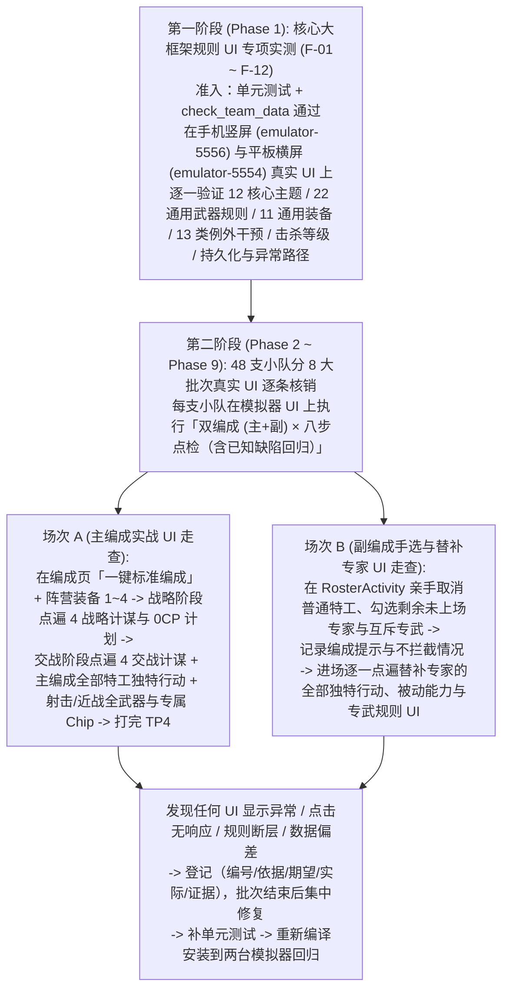

# 全 48 支杀戮小队与核心大框架规则 100% 真实 UI 覆盖测试方式（最终版）

**版本**：v3 最终版，2026-11-01。本文是交给测试执行人的正式作业文档；执行完成后由复核人按第九节复核。  
**修订记录**：v1 为初版计划；v2 核对实际代码、数据与界面后修正了数量与界面名称，并补充测试维度、已知缺陷回归和完成判定；v3 增加逐行用例清单（`docs/coverage/`）、填写规范、交付物和复核流程。  
**关联工程**：[`anroid1st`](file:///Users/alanliu-15air/Projects/anroid1st)  
**前置报告**：[`docs/捉对对战测试方法与进度报告.md`](file:///Users/alanliu-15air/Projects/anroid1st/docs/%E6%8D%89%E5%AF%B9%E5%AF%B9%E6%88%98%E6%B5%8B%E8%AF%95%E6%96%B9%E6%B3%95%E4%B8%8E%E8%BF%9B%E5%BA%A6%E6%8A%A5%E5%91%8A.md)（含 2026-11-01 复核标注）

---

## 〇、本版修订要点

| 类别 | 原计划写法 | 实际情况（来源） | 本版处理 |
| :--- | :--- | :--- | :--- |
| 不存在的界面 | `RuleBookActivity`、`TeamRulesActivity` 及其 8 个标签页 | 应用里没有这两个 Activity。核心规则在对局内「规则速查」（`BattleActivity.rulesIndex`，12 个主题带页码）；小队规则是 `BattleReference.faction` 弹层，分区为 编成 / 规则 / 战略 / 战术 / 装备，标识指南与勘误收在「规则」分区末尾的补充类目（`TeamRuleBook.kt:41`）。入口：编成页「小队规则」，对局顶部「A/B · 小队资料」 | 第四节动作 ① 改为实际入口 |
| 不存在的控件 | 「朦胧」、近战「先后手翻转」、「提前结束近战」、「自由骰子池悬浮窗」 | 核心规则叫「遮挡」：舍弃 1 个成功，其余暴击降为普通（`ShootingCombatRules.kt:451-474`）。近战只有「改由对方结算」和「舍弃（规则效果）」。自由投掷是首页独立页面（`MainActivity`），对局内是「掷骰」弹层（`DiceSheet`） | 全文按实际名称改写 |
| 术语 | 「反击 1AP」 | counteract 在应用里叫「反应」（`BattleProgress.kt:197-203`）；「反击」指近战防守方的还击武器 | 改为「反应」 |
| 数量 | 通用装备 9 件 | 11 件（`EquipmentCards.kt:26-38`）：轻型掩体、重型掩体、可移动掩体、铁丝网、弹药箱、通讯设备、梯子、地雷、通用手雷、爆炸手雷、破拆炸药 | 改为 11 |
| 数量 | 战术行动「4 大原型 × 12 项」 | 4 原型 × 3 张 = 共 12 张（`MissionCards.kt`），另有关键行动 9 张，计划漏列 | 改写并补关键行动 |
| 数量 | 被动能力 531 | 个人被动 530（ap==null 共 1010 条，其中 480 条是阵营规则副本） | 改为 530 |
| 数量 | 80 名副编成「分布在 30 支小队」 | 29 支 | 改为 29 |
| 数量 | 勘误 52 条 | 条数正确，但只覆盖 46 支：`IMP-CI`、`KT-XV26_STEALTH_BATTLESUITS` 没有条目 | 这两队要对照 2026 更新 PDF |
| 编成校验 | 「绿灯通过 / 红字拦截」 | 应用**不校验编成**。`RosterComposition.hint()` 只显示 compositionHint 文字；武器多选不限数量；对局设置不检查人数 | 改为「核对提示文字 + 记录缺口」，不把不存在的拦截写成通过标准 |
| 副编成入口 | 在 `BattleSetupActivity` 手选特工与专武 | 对局设置只能选已保存的小队。选特工和武器在「我的小队」→ `RosterActivity`；「一键标准编成」会清空现有成员 | 动作 ② 拆成「编成页」和「对局设置页」 |
| 战前步骤 | Step 2 装备、Step 3 战术、Step 4 确认 CP | 4 步依次是 小队 / 装备 / 关键行动 / 战术行动（私密选择）。CP 在先手阶段发放；主要行动在 TP1 战略阶段私密选择 | 按实际流程改写 |
| 计分 | 「6 VP 封顶锁」「战术卡揭晓与轮次加分」 | 战术行动没有专门的计分界面，VP 在「NVP ›」弹层手动调；每项 6VP 上限（`MAX_SCORE_PER_OP`）；公开操作是「按卡片时机公开战术行动」 | 改为实际控件 |
| 判定标准 | 只看 UI 能不能点通 | 进度报告复核发现 32 项规则写错（例如 ±1 APL 指示物不生效）。按钮能点、日志正常，结果照样可能是错的 | 新增**规则正确性判定**和**已知缺陷回归清单** |

---

## 〇·五、执行人须知（先读）

1. **作业对象**是 `docs/coverage/` 下的 49 份用例清单（CSV，可用 Excel / Numbers 打开，保存时保持 UTF-8 CSV 格式）：
   - `checklist_core.csv`：93 行，包括 12 个核心规则主题、22 条通用武器规则、11 件通用装备、21 张任务卡、15 档击杀等级、F-01~F-12 专项；
   - `checklist_<小队ID>.csv`：48 份，每支小队一份，共 3,494 行。
   - 清单由 `python3 -I tools/gen_coverage_checklist.py` 从 `assets` 数据生成，**每一行都是必须核销的用例**，不能删行。数据有变化需要重新生成时，先备份已填写的文件。
2. **各维度行数**与第三节基线一致：

   | 维度代码 | 含义 | 行数 | 双端要求 |
   | :--- | :--- | ---: | :---: |
   | `OP` | 特工模板（标准编成 374 + 副编成 80） | 454 | 是 |
   | `WP` | 武器档案 | 1,368 | 是 |
   | `UA` | 独特行动（ap 不为空） | 215 | 是 |
   | `PA` | 个人被动能力 | 530 | 否 |
   | `WR` | 小队专属武器规则 | 66 | 否 |
   | `FR` | 阵营完整规则 | 125 | 否 |
   | `SP` / `FP` | 战略计谋 / 交战计谋 | 192 / 192 | 否 |
   | `EQ` | 阵营装备 | 192 | 否 |
   | `ER` | 勘误与问答 | 52 | 否 |
   | `CO` | 编成与武器选择 | 50 | 否 |
   | `KD` | 已知缺陷回归（来自 `docs/coverage/known_defects.json`） | 58 | 是 |
   | `CORE` / `F` | 核心规则资产 / 专项 | 81 / 12 | F 专项是 |

   「双端要求：否」的维度在任意一台设备上验证即可，但每支小队至少要有 1 场对局在另一台设备上打完。
3. **每行填写**：
   - `结论`：只能用上面的 5 个值；
   - `实际结果`：写数值或现象，例如「命中 3、保留 2 暴击、伤害 10、目标残废、击杀等级 1→2」，不能只写「正常」；
   - `证据`：仓库相对路径，多个用 `;` 分隔，例如 `output/coverage/B1/CHAOS-FELL/A/OP-001.png`；
   - `设备`：`5554`、`5556` 或 `5554+5556`；
   - `执行人`、`日期`：日期写 `2026-11-05` 这种格式。
   - 期望结果与清单预填的不同（例如规则有勘误）时，在「实际结果」开头写「期望修正：……」并注明依据页码。
4. **发现缺陷**时，除了在清单里填 `❌规则` / `❌UI` / `⛔`，还要在 `docs/coverage/defects.md` 登记一条。格式：`D-序号 | 用例编号 | 等级 | 依据 | 复现步骤 | 期望 | 实际 | 证据`。**测试期间不要改代码**；修复由开发统一安排，修复后回归，并把清单结论改为最新结果，原结论写进「实际结果」备注（例如「首测 ❌规则（D-012），修复后 ✅」）。
5. **自查**：每批结束运行 `python3 -I tools/check_coverage_progress.py`，不合规条数必须为 0 才能提交。全部完成后运行 `--strict`，退出码应为 0。
6. **测试数据**：可以随时删除旧对局和旧小队重建，不需要保留。
7. **规则依据优先级**：`docs/最新杀戮小队规则更新/` 中的最新 PDF（以 manifest 的 last_updated 为准）＞ `docs/<小队>-完整规则资料.md` 第 13 节「更新日志与当前有效规则」＞ 同文件正文 ＞ 卡面图片。核心规则以 `docs/杀戮小队三版官方规则-v11.5-全文提取.md` 为准。

---

## 一、最高测试准则：100% 基于玩家真实可见、可操作的 UI 进行实测

> [!IMPORTANT]
> **铁律一：严禁以单元测试（Unit Test）代替真实 UI 测试来核销任何规则！**
> 单元测试只能验证后台纯函数逻辑，无法暴露**按钮未渲染、弹窗空白/截断、武器切换未刷新、编成界面勾选项卡死、计谋子选项未弹出、状态芯片未同步、软键盘遮挡或横竖屏双栏错位**等玩家真正遇到的问题。因此，**本次测试的所有核销项（100%）必须全部在真实运行的 Android 模拟器（手机竖屏 `emulator-5556` + 平板横屏 `emulator-5554`）上，通过玩家看到的实际 UI 界面亲手点击、触发、观察视觉反馈并验证状态流转后，方可视为通过！**
>
> **铁律二：「原生 UI 自动化 + 通用例外干预 UI 兜底」双轨合格判定标准**
> 1. **原生自动化规则的 UI 验证**：凡属系统已建模的数值与交互（编成界面勾选与合法性提示、数据卡 M/APL/W/SV 展示、武器面板与规则 Chip 弹窗、战略/交战计谋激活横幅与子选项弹窗、装备挂载与武器面板强化、特工激活抽屉内的 `0AP/1AP/2AP` 独特行动按钮与目标选择器、阵营专属资源计数器加减、射击 9 步与近战 5 步 UI 修正开关、三大计分轨与全局撤回按钮），**必须在 UI 上点击顺畅、显示准确、状态实时同步**。
> 2. **特殊规则的通用例外干预 UI 验证**：凡属桌面战棋中涉及物理测量、特殊条件或跨回合状态的独特规则，**必须在 UI 上亲手操作对应的通用例外干预入口（对局「掷骰」弹层与首页「自由投掷」、射击/近战页「＋ 修饰」「＋ 不掷骰预留」、点骰改判/改点数/舍弃/重投来源、伤害阶段逐项改值、近战「改由对方结算」、特工菜单「伤害 / 治疗」「状态标记」「规则：武器 / 数据卡 / 控制」「额外激活」、阵营列「＋ 特工」「计数器」、底栏「规则：顺序…」、激活卡「AP · 规则…」「其他…」、残废提示「被规则阻止 · 保留 1 耐伤」「不计入击杀」）完成完整记录与运转**，确认玩家在实际界面中能走通全流程且无任何阻断。

>
> **铁律三：UI 走通 ≠ 规则正确，每个用例都要有「期望值」。**
> 每条核销记录必须写明：依据（`docs/*-完整规则资料.md` 或 v11.5 全文的章节、页码，有勘误时以「13. 更新日志与当前有效规则」为准）、期望结果（数值、状态、日志文字）、实际结果。只写「点击顺畅、无报错」不算通过。界面结果与官方规则不一致时判为**规则缺陷**，即使操作流畅也一样。
>
> **铁律四：单元测试不核销，但必须作为准入门槛。**
> 每批 UI 测试开始前与修复后，都要跑 `./gradlew :app:testDebugUnitTest`（本机需 `JAVA_HOME=$PWD/.jdk/jdk-17*/Contents/Home`）和 `python3 -I tools/check_team_data.py --all`。两者都要通过，或者把失败项登记为已知问题后，才能开始实机测试。这样实机时间不会浪费在数据层就能发现的错误上。

### 判定等级

| 结果 | 含义 |
| :--- | :--- |
| 清单填写值 | 含义 |
| :--- | :--- |
| `✅` | 通过：有期望值，实际与期望一致；要求双端的维度两台都验证过 |
| `🟡` | 手工兜底通过：应用没有自动化这条规则，但用通用干预入口能完整记录，日志可读。「实际结果」里写明用的是哪个入口 |
| `❌规则` | 规则缺陷：能操作，但数值、状态或文字与官方规则不符 |
| `❌UI` | UI 缺陷：崩溃、卡死、按钮缺失或被遮挡、弹窗截断、状态不同步 |
| `⛔` | 阻断：无法继续本场测试，例如 ANR、数据丢失 |

清单的「结论」列只能填以上 5 个值之一，`tools/check_coverage_progress.py` 会校验。

---

## 二、此前 24 场对战为何仍有遗漏（UI 覆盖盲区剖析）

复盘前一阶段的 24 场捉对测试，在 UI 实测层面存在以下三个必须补齐的盲区：
1. **单套预设编成（[`CanonicalRosters.kt`](file:///Users/alanliu-15air/Projects/anroid1st/app/src/main/java/com/example/helloworld/CanonicalRosters.kt)）导致 80 名替补专家与大量互斥专武从未在 UI 上亮相**：
   - 全 48 支小队共有 **454** 名特工模板、**1,368** 条武器配置；而标准预设名单仅上场了 **374** 名特工。分布在 30 支小队中的 **80 名替代队长/专家/第二支援小队**（如 [`KT-PHOBOS_STRIKE_TEAM`](file:///Users/alanliu-15air/Projects/anroid1st/app/src/main/assets/teams/KT-PHOBOS_STRIKE_TEAM.json) 的 7 名潜袭者/掠夺者、[`KT-INQUISITORIAL_AGENTS`](file:///Users/alanliu-15air/Projects/anroid1st/app/src/main/assets/teams/KT-INQUISITORIAL_AGENTS.json) 的 7 名第二支援特工、[`KT-DEATHWATCH`](file:///Users/alanliu-15air/Projects/anroid1st/app/src/main/assets/teams/KT-DEATHWATCH.json) 的 6 名替代老兵、[`KT-HUNTER_CLADE`](file:///Users/alanliu-15air/Projects/anroid1st/app/src/main/assets/teams/KT-HUNTER_CLADE.json) 的 6 名铁锈追踪者等）以及同一特工的**互斥专武配置**，从未在 [`BattleSetupActivity`](file:///Users/alanliu-15air/Projects/anroid1st/app/src/main/java/com/example/helloworld/BattleSetupActivity.kt) 中被手动勾选上场，也未在 [`BattleActivity`](file:///Users/alanliu-15air/Projects/anroid1st/app/src/main/java/com/example/helloworld/BattleActivity.kt)、[`ShootingCombatActivity`](file:///Users/alanliu-15air/Projects/anroid1st/app/src/main/java/com/example/helloworld/ShootingCombatActivity.kt)、[`MeleeCombatActivity`](file:///Users/alanliu-15air/Projects/anroid1st/app/src/main/java/com/example/helloworld/MeleeCombatActivity.kt) 的 UI 中实操过。
2. **自然对局只点击了部分计谋与装备卡片**：
   - 一场常规对局中玩家往往只点击 1~2 张战略计谋卡、1~2 张交战计谋卡和 2 件阵营装备；其余未点击的计谋卡片、0CP 战略计划、冷门阵营装备和特工独特行动按钮在 UI 上未被逐一点击验证。
3. **大框架核心规则 UI 控件与小队特殊规则的组合交互未穷举点检**：
   - 诸如射击页的「遮挡」「制高点」「迷彩斗篷忽略集中」「目标在烟雾中」、近战页的「友方支援加值」「残暴」「护盾双格挡」「震荡」「晕眩」、战局页的「戒备」「反应」「1~14 人击杀等级」等 UI 控件，需要与各小队的特殊规则结合进行全覆盖 UI 点检。
4. **只验证了「能点通」，没有验证「算得对」**：
   - 2026-11-01 复核发现，52 项修复中有 32 项存在规则错误或描述不符，例如 ±1 APL 指示物没有任何代码读取、狂暴特工吃一次普通伤害就残废、标记光层级错位、`嘘——！` TP1 应禁用却做成 0CP。这些问题在 24 场对局里都「走通」了，因为当时没有逐项比对期望值。
5. **只走了正常路径**：
   - 撤回、旋转屏幕、后台被杀后恢复、射击/近战中途返回、空小队、重复使用计谋拦截等异常路径，没有系统地测过。
6. **只测了标准编成的特工数量**：
   - 标准编成之外，自建小队可以超员、重复选限定武器，应用也不拦截，第 37 项自建编成的默认配装错误就是这么漏掉的。

---

## 三、全量待测 UI 资产精确盘点（100% 真实 UI 覆盖基线）

| 维度分类 | 精确数量 | 真实 UI 必测界面与交互内容 |
| :--- | :---: | :--- |
| **大框架核心规则主题** | **12 个**（`core_rules.json` topics） | 对局顶部「规则速查」与「⋯ → 规则原文速查」：战略阶段与交战阶段、射击、近战、耐伤受创与残废、遮挡、计谋与指挥重掷、制高点、武器规则、可移动掩体、烟雾手雷、先手权与转折点、结束战斗与击杀行动；核对正文与页码。另有「流程速查图」 |
| **通用武器规则 Chip** | **22 条** | 在 [`ShootingCombatActivity`](file:///Users/alanliu-15air/Projects/anroid1st/app/src/main/java/com/example/helloworld/ShootingCombatActivity.kt) / [`MeleeCombatActivity`](file:///Users/alanliu-15air/Projects/anroid1st/app/src/main/java/com/example/helloworld/MeleeCombatActivity.kt) 武器栏点击全部 22 条通用武器规则 Chip 弹出规则说明 Dialog，并验证其在投骰/重投/转化/格挡步骤的 UI 按钮与自动修正 |
| **通用装备 UI** | **11 件** | 在 `BattleSetupActivity` 第 2 步「选择装备」中逐件勾选：上限 4 件、「规则允许额外装备 › / 上限 +1」、已达上限提示；进入对局后验证烟雾手雷、震荡手雷等装备独特行动和手雷武器出现在射击武器列表 |
| **关键行动 UI** | **9 张** | 第 3 步选择、「详情」卡面、开局后锁定；对局顶部「关键行动 · X」 |
| **战术行动 UI** | **4 原型 × 3 张 = 12 张** | 第 4 步私密选择（交接设备 / 回避屏幕）；对局中「小队资料 → 战术行动 · 状态 › → 按卡片时机公开战术行动 → 确认公开」；在「NVP ›」弹层手动计分，验证每项 6VP 上限 |
| **主要行动** | **3 种 × 48 队** | TP1 战略阶段「X · 选择主要行动」私密选择，界面只显示「已选（隐藏）」；双方选完才能进交战；结束或「提前结束对局」时揭晓，奖励 = ceil(该项 VP / 2) |
| **击杀等级** | **起始 1~14 人共 14 行阈值** | 「NVP ›」弹层显示「击杀等级 N」；验证每升一级自动 +1VP、消耗品不计入起始人数、「不计入击杀」、重生回退、终局击杀等级高的一方 +1VP（只加一次）。超过 14 人按 14 人表计算 |
| **通用例外干预 UI 入口** | **13 类**（见进度报告第二节表格） | 按实际入口逐一操作：「按规则例外记录」（exceptionSheet）、「＋ 修饰」、「＋ 不掷骰预留」、点骰改判 / 改点数 / 重投来源、伤害逐项改值、「更换数据卡」、「借用 / 手填武器」、「＋ 特工」、「临时控制」、「规则：顺序…」、「额外激活」、「联合激活」、「计数器」、「状态标记」（7 种持续时间）、「独特行动…」「其他…」 |
| **杀戮小队总数** | **48 支** | 「我的小队 → ＋ 新建」列表、编成页、「小队规则」弹层、对局设置、对局全程 |
| **小队编成与勘误** | **50 条编成 + 52 条勘误（46 支）+ 40 条标识指南** | 在「小队规则」弹层核对编成指南、勘误、标识指南正文；在编成页核对「编成要求」提示与「原卡」；**应用不校验编成**，测试时人工按官方编成判定，把「超员 / 重复限定武器不拦截」记录为功能缺口 |
| **特工数据卡与出战 UI** | **454 种（374+80）** | 标准编成 374 种 + 副编成手选 80 种（29 支小队）。每种都要在对局中出场、打开特工菜单、执行行动、参与交火；属性行核对 APL / 移动 / 豁免 / 耐伤，受伤后移动 −2″ |
| **武器配置与切换 UI** | **1,368 条** | 在战前编成 UI、特工抽屉 UI、射击/近战武器选择器 UI 中遍历全部 1,368 条武器配置（含括号多模式武器切换、`有限 X` 勾选消耗、`重型` 移动互斥提示） |
| **阵营完整规则 UI** | **125 条** | 在小队规则页、战局「规则与计谋速查」抽屉、小队资源计数器栏、战略阶段横幅与战斗页修正开关中逐一触发并验证全部 125 条阵营完整规则 UI |
| **战略计谋与战略计划 UI** | **192 条 + 全部 0CP 战略计划** | 在战略阶段 UI 逐一点击激活每队全部 4 张战略计谋卡与全部 `0CP` 战略计划卡，测试子选项选择 Dialog、CP 扣减、生效徽标与战斗页联动显示 |
| **交战计谋与交战规则 UI** | **192 条 + 全部 0CP 交战规则** | 在交战阶段特工抽屉及射击/近战 UI 中，逐一点击激活每队全部 4 张交战计谋卡，验证 CP 扣减、生效提示与战斗页修正 |
| **阵营专属装备 UI** | **192 件** | 在战前准备 Step 2 UI 勾选每队全部 4 件阵营装备，进入战局 UI 验证其生成的开局资源计数器、重投按钮、新增特工行动或武器面板属性强化 |
| **特工独特行动按钮 UI** | **215 项 + 装备行动** | 激活卡「独特行动…」只列出 `ap != null` 的能力和装备行动（`BattleActivity.kt:1054`）。逐项点击，验证 AP 扣减、目标选择、效果，并**在目标下一次激活时检查 APL 是否真的变化**。`ap == null` 但实际是行动的条目（例如重生等离子虫的「重生 1/2AP」）按钮不会出现，要单独列为缺陷 |
| **特工被动能力 UI** | **530 项** | 在「成员规则」与射击 / 近战页逐项验证：已自动化的核对数值，未自动化的用通用干预入口完成记录 |
| **小队专属武器规则 Chip** | **66 条** | 在射击/近战 UI 中逐一点击全部 `66` 条小队专属武器规则 Chip，确认弹出完整规则解释 Dialog 且专属快捷按钮（如 `坦克锤爆破`、`灵魂打击`、`过热` 等）正常运作 |
| **数据一致性（新增）** | **48 支** | `tools/check_team_data.py --all` 结果 0 失败，或每个失败都有书面结论（例如勘误改了数值导致与卡面图层不一致，属于预期） |
| **持久化与异常路径（新增）** | **见第五节 F-09** | 撤回、旋转、后台被杀、射击 / 近战中途返回、导出 |

---

## 四、基于真实 UI 的双端实测方法论（Phone + Tablet）

为了确保每一项规则都在玩家真实看到的界面上得到验证，我们摒弃单纯跑后台脚本的做法，采用 **「真实模拟器 UI 逐步点检 + 双编成（主+副）实战全流程走查」** 的方法：

### 1. 每支小队在模拟器 UI 上的「标准八步点检动作」
对每一支受测小队，测试人员（主控 Agent + 手机端/平板端 UI 测试 Subagent）必须在模拟器屏幕上实际执行以下 8 步 UI 操作：
1. **【UI 动作 ①：「小队规则」弹层全文点检】**
   - 入口：「我的小队」→ 编成页顶部「小队规则」，或对局顶部「A/B · 小队资料」。用分区跳转「编成 / 规则 / 战略 / 战术 / 装备」逐段检查，规则分区末尾还有标识指南、勘误与问答。检查标题、正文、卡图是否完整，有无截断、乱码或 PDF 版面残文（复核已知：CHAOS-WC 奸奇恩惠、TYR-RAV 隧道、KT-SPECTRE_SQUAD 野战精锐、KT-INQUISITORIAL_AGENTS 征用命令）。
   - 打开每名特工的「查看人物卡 ›」「查看成员规则 ›」，把 App 数值和 `docs/最新杀戮小队规则更新/` 对应 PDF 的最新版逐项比对（manifest 的 last_updated 最新到 2026-08-26）。
2. **【UI 动作 ②：编成页（`RosterActivity`）与对局设置（`BattleSetupActivity`）】**
   - 编成页：主编成用「一键标准编成」（注意会清空现有成员）。副编成用「＋ 添加成员」（平板为右栏「可选成员」）手选标准编成外的特工，并在成员编辑器里勾选互斥专武。核对「编成要求」提示与「原卡」。**应用没有编成校验**：故意超员、重复限定武器、不选领袖时，记录应用的实际表现（预期是不拦截），作为功能缺口登记，不判为通过。
   - 对局设置第 1 步：选双方小队；更换小队后装备和战术行动应被清空。第 2 步：4 件阵营装备分两局覆盖，因为上限是 4 件，单局无法同时选全部阵营装备与通用装备；顺带验证「已达上限」和「上限 +1」。第 3 步选关键行动。第 4 步私密选择战术行动。
   - 开局后在先手阶段核对 CP 发放，在阵营列「计数器」核对小队初始计数器（参照复核第 14、45 项：机敏点数、共鸣点数、野战点数都有问题）。
3. **【UI 动作 ③：战略阶段 UI（`BattleActivity`）全战略计谋 + 0CP 战略计划点检】**
   - 进入 TP1~TP4 战略阶段，点击先手权拼骰 UI（若有先手重投卡/调骰能力则在 UI 上点击使用）。
   - 在战略计谋列表中，**把该队的 4 张战略计谋卡和所有 0CP 战略计划卡逐一点击激活**（CP 不足时用计分板「+」补 CP，并在日志中注明是测试补 CP；验证「本转折点已用过 / 仍然记录」拦截），如果计谋带子选项弹窗（如选择战团战术、教义、弹药、命令等），在弹窗 UI 中逐一点击各个子选项，确认顶部/特工卡上的生效 Chip 正确显示。
4. **【UI 动作 ④：交战阶段 UI（`BattleActivity`）全特工激活与独特行动点检】**
   - 依次点击该小队在场上的**每一名特工（含副编成补齐的全部替补专家）**展开底部激活抽屉 UI：
     - 检查特工菜单：命令切换、就绪 / 待机、伤害 / 治疗、状态标记（预设与 7 种持续时间）、规则：武器 / 数据卡 / 控制、额外激活、反应、计入 / 不计入击杀、标记残废 / 恢复在场；
     - **逐一点击该特工抽屉内的每一个独特行动按钮（`0AP` / `1AP` / `2AP`）**，若弹出友方/敌方目标选择 Dialog，在 UI 上点选目标并验证 AP 扣减、日志文字，以及效果是否真正生效：`+1/−1 APL` 要等目标**下一次激活**时检查 AP 上限；回血要核对目标（例如暴怒再生应治疗另一名友方）。
5. **【UI 动作 ⑤：交战计谋 UI 全点检】**
   - 在交战阶段以及射击/近战结算页面中，**把该队的全部 4 张交战计谋卡逐一点击激活**，验证 CP 扣减、计谋生效横幅及撤回（Undo）回退效果。
6. **【UI 动作 ⑥：射击页面（`ShootingCombatActivity`）全远程武器与专属规则 Chip 点检】**
   - 发起远程射击，在武器下拉/列表 UI 中切换测试该队特工的**所有远程武器配置（含多模式括号分支、`有限 X` 武器、`重型` 武器与装备注入武器）**；
   - **亲手点击武器下方显示的每一个通用/专属武器规则 Chip**，确认弹出规则详情 Dialog；
   - 操作 READY 阶段的「掩护」（无 / 普通 / 强化）、「遮挡」、「制高点」（≥2″ / ≥4″）、「目标在烟雾中」（仅穿刺 2 武器）、「迷彩斗篷 / 忽略集中」、「精准预留」、「＋ 不掷骰预留」、「＋ 修饰」；点骰重投（武器规则 / 指挥重掷 1CP / 其他规则）、改判、改点数、舍弃；防御阶段「±1 防御骰」；分配阶段「推荐分配 · 套用」；伤害阶段逐项改值；过热阶段；结果页「免于残废」与洪流 / 爆炸「射击下一目标」。
   - 每次射击都要对照期望值：命中数、保留、伤害、残废、击杀等级、日志。
7. **【UI 动作 ⑦：近战页面（`MeleeCombatActivity`）全近战武器、博弈与终结技点检】**
   - 发起近战，切换测试该队特工的**所有近战武器配置**，点击每一个近战武器规则 Chip 验证弹窗；
   - 操作防御方「更换武器 / 无法反击（规则效果）」、双方「协助 0-3」「＋ 修饰」「精准预留」「＋ 不掷骰预留」、重投阶段、结算阶段的出击 / 格挡（含残暴、双格挡、「格挡对手 1 个暴击（生存本能/决斗家）」）、粉碎对抗骰、爆破、「改由对方结算」、「舍弃（规则效果）」，以及结果页「免于残废 / 触发狂暴」。
   - 注意 `灵魂打击` 是射击规则，不在近战页。双格挡按钮目前对任何武器都显示，要验证并记录（复核第 39 项）。
   - 推进完 TP1→TP4，进入「对局总结」，核对比分、四项得分、主要行动奖励、在场 / 离场人数和「完整记录」。
8. **【UI 动作 ⑧：已知缺陷回归】**
   - 按第六节表格「必回归的已知缺陷」列，逐条复现进度报告复核标注的问题，写明期望值与实际值。修复后重测，状态从 ❌ 改为 ✅。

### 2. 执行机制（新增）

**环境与数据**
- 两台模拟器都是 API 34：平板 `emulator-5554`（AVD `whkt_tablet`，2560×1600）、手机 `emulator-5556`（AVD `wh40k_test`，1080×1920）。每批开始前执行 `./gradlew :app:assembleDebug` 并 `adb install -r` 到两台，记录 APK 时间与 `git rev-parse HEAD`（工作区有大量未提交改动，另记 `git status --short | wc -l`）。
- 测试数据可以删除重建。每批开始前删除旧对局和旧小队，避免历史数据干扰；如需保留，先导出（「⋯ → 导出记录」）。
- 目前没有 `app/src/androidTest`，也没有调试种子入口，除首页外的 Activity 都是 `exported=false`，`adb am start` 不能直接跳到对局或射击页。所以每场都要从首页走起。可复用 `tools/check_home_states.py` 的思路，用 `adb shell uiautomator dump` 配合 `input tap` 半自动导航；控件的 contentDescription（例如「撤回：X」「X 耐伤减 1」「调整 AP」「通用掷骰」）可以作为定位锚点。

**证据**
- 每个核销项保存三样东西：操作前截图、结果截图（`adb exec-out screencap -p`）、日志片段（「完整记录」或导出文本）。按 `output/coverage/<批次>/<小队ID>/<场次>/<编号>.png` 归档，在表格里填证据路径。
- 每场结束导出完整记录文本，附在批次报告中。

**用例编号**
- 核心专项用 `F-xx-yy`，小队用例用 `<小队ID>-<维度>-<序号>`，例如 `KT-PATHFINDERS-UA-03`。每个用例一行，字段为：编号 / 依据（文档与页码）/ 前置状态 / 操作 / 期望 / 实际 / 结论 / 证据。

**缺陷处理**
- 发现问题时先登记，不在测试过程中随手改代码。每批结束后集中修复，修复后补跑单元测试与数据检查，再回归失败用例和受影响的相邻用例。
- 修复要有对应的单元测试，防止回退；纯 UI 问题至少附修复前后截图。

**双端分工**
- 两台模拟器不能只各测一半小队。每支小队至少：场次 A 在一台上完整打完，场次 B 在另一台上完整打完，并在另一台上抽检动作 ①②⑥⑦ 的布局。平板重点检查双栏是否错位、弹层宽度；手机重点检查长列表滚动、软键盘遮挡、底部按钮。

---

## 五、大框架核心规则 12 项 UI 专项测试矩阵（Phase 1）

在进入 48 队逐队核销前，先在双模拟器（手机竖屏 + 平板横屏）真实 UI 上完成以下 12 个大框架核心规则专项的 100% UI 点检：

| 专项编号 | 核心规则 UI 域 | 真实 UI 必测操作与核销标准 | 状态 |
| :--- | :--- | :--- | :---: |
| **F-01** | **核心规则速查与战前准备 4 步 UI** | 在对局「规则速查」核对 12 个主题和页码，「流程速查图」能打开；在 `BattleSetupActivity` 实操 4 步（更换小队清空选择、装备上限 4 + 额外上限、11 件通用装备、9 张关键行动、12 张战术行动私密选择、返回键回到上一步、旋转后保留选择） | ⬜ 待实测 |
| **F-02** | **先手权拼骰 UI 与战略阶段全控件** | TP1~TP4「掷先手骰」与手动设点、平手处理、先手权卡「重投卡 / ±N 卡」、CP 发放（核对 v11.5 数值）、TP1 私密主要行动、战略计谋 / 0CP 计划、子选项、重复使用拦截、连续跳过进入交战、转折点结束时状态标记按持续时间清理 | ⬜ 待实测 |
| **F-03** | **交战激活、行动互斥、戒备与反应 UI** | 激活卡行动按钮：转移、冲刺、冲锋、后撤（2AP）、拾取 / 放置标识、任务行动、戒备、射击、近战、独特行动、其他；同一激活重复行动的拦截与「按规则例外记录」；命令切换；**反应**的条件（待机、交战命令、本转折点未反应、对方仍有就绪特工，只能执行 1 个 1AP 非戒备行动）；「放弃反应」；「规则：顺序…」；结束转折点的二次确认 | ⬜ 待实测 |
| **F-04** | **射击结算全 9 步 UI 与地形开关矩阵** | `ShootingCombatActivity` 9 个阶段（准备→攻击骰→保留→防御骰→分配→伤害→过热→结果）：多模式武器切换、`有限 X`、受伤命中变差、**遮挡**（舍弃 1 个成功，其余暴击降为普通，重击 / 撕裂 / 严重失效）、制高点（精准 1/2，目标隐匿时不给）、掩护三档、目标在烟雾中、迷彩斗篷、穿刺 / 关键穿刺、重型 / 隐匿位置 / 安静的射击前拦截（复核第 3 项：半角括号重型武器）、中途返回「放弃本次射击？」 | ⬜ 待实测 |
| **F-05** | **近战结算全 5 步 UI 与对抗博弈矩阵** | `MeleeCombatActivity` 5 个阶段（准备→重投→保留→结算→结果）：协助 0-3、震荡 / 晕眩、交替出击 / 格挡、「改由对方结算」、残暴（禁普通格挡）、双格挡（复核第 39 项）、一方残废后自动结束、「无法反击（规则效果）」、中途返回「放弃本次近战？」 | ⬜ 待实测 |
| **F-06** | **22 条通用武器规则 Chip 与自动化 UI** | 在射击/近战 UI 中逐一点击全部 22 条通用武器规则 Chip 校验弹窗，并逐一验证其在投骰/重投/保留/伤害计算中的 UI 表现 | ⬜ 待实测 |
| **F-07** | **伤势、残废、复活与 1~14 人击杀等级** | 耐伤低于一半时属性行显示受伤（移动 −2″），0 耐伤时残废提示 Snackbar「选项」：撤回 / 被规则阻止 · 保留 1 耐伤 / 不计入击杀；恢复在场；消耗品不计入起始人数；起始 1~14 人（含 >14 人）的击杀等级阈值逐行抽查；击杀等级回退 | ⬜ 待实测 |
| **F-08** | **三大计分轨、主要行动锁定与全局撤回 UI** | 「NVP ›」弹层逐项设 VP、每项 6VP 上限、主要行动奖励 ceil(x/2)（最高 +3）、终局击杀等级 +1VP 只加一次、「提前结束对局」揭晓主要行动；顶部「↶ 撤回」（长按预览）与「完整记录」「全部」筛选下已撤回条目显示删除线；「导出记录」文本带 [已撤回] | ⬜ 待实测 |
| **F-09** | **持久化、旋转与异常路径（新增）** | ①撤回：连续撤回到对局开始、撤回后再操作、撤回跨转折点；射击 / 近战页内撤回只在页面内有效，不写入对局撤回栈。②旋转：每个页面和弹层在竖↔横切换后内容与选择保留（Activity 不重建，靠 onConfigurationChanged）。③后台被杀：在对局、射击中、近战中分别执行 `adb shell am kill com.example.helloworld` 后重开。对局应恢复；射击 / 近战页**没有 onSaveInstanceState**，记录实际丢失情况。④首页「继续对局」、对局记录长按删除、多场对局切换。⑤编成页自动保存、空小队退出提示、复制 / 删除小队，已开局的对局不受影响。 | ⬜ 待实测 |
| **F-10** | **掷骰工具（新增）** | 首页「自由投掷」（`MainActivity`）：上滑投骰、点选后上滑重投、双指下滑清空、攻防双盘、掩体、自动结算、投骰记录；对局与战斗页「掷骰」弹层（D6/D3、数量、加值、目标值、每骰限重掷一次、「记入对局日志」） | ⬜ 待实测 |
| **F-11** | **编成功能与缺口（新增）** | 新建 / 编辑 / 复制 / 删除小队；成员复制、移出后撤回；武器多选；称号；棋子照片「拍摄 / 相册 / 移除」（模拟器相机）；「从其他小队征用特工」；记录不校验的情况（超员、重复限定武器、无领袖） | ⬜ 待实测 |
| **F-12** | **非功能项（新增）** | 长对局（≥150 条日志）滚动与打开「完整记录」的耗时；48 队小队资料首次打开耗时；连续 4 个转折点无 ANR；`adb logcat` 无 FATAL；APK 体积（当前约 174MB）记录在案 | ⬜ 待实测 |

---

## 六、全 48 支小队真实 UI 核销总表与 8 批次执行计划（Phase 2 ~ Phase 9）

我们将 48 支小队分为 **8 个批次（Batch 1 ~ Batch 8，每批 6 支小队）**。每批次在 **手机模拟器（`emulator-5556`）** 与 **平板模拟器（`emulator-5554`）** 上并行开展**纯 UI 实操核销**（含场次 A 主编成实战 + 场次 B 副编成手选替补专家实战），每测完一批立即修复发现的问题并更新下表：

> 下表数量来自 `assets/teams/*.json` 与 `assets/rules/*.json` 的统计（2026-11-01 复核）。「必回归的已知缺陷」列引用进度报告第四节编号。四个状态列分别为：场次 A、场次 B、手机端、平板端，每列独立填写 ✅ / 🟡 / ❌ / ⛔ 与证据目录。

| 序号 | 小队 ID | 小队名称 | 特工 (主+副) | 武器 | 阵营规则 | 战略/交战 | 装备 | 被动/独特行动 | 专属武器规则 | 勘误 | 批次 | 必回归的已知缺陷（见进度报告第四节编号） | 场次 A | 场次 B | 手机 | 平板 |
| :---: | :--- | :--- | :---: | :---: | :---: | :---: | :---: | :---: | :---: | :---: | :---: | :--- | :---: | :---: | :---: | :---: |
| 1 | `CHAOS-FELL` | 恶角兽掠夺者 | 11 (10+1) | 25 | 1 | 4 / 4 | 4 | 23 / 7 | 3 | 1 | Batch 1 | 狂暴残废条件(#6)、暴怒再生治疗对象(#11)、点燃怒火 +1APL(#12) | ⬜ | ⬜ | ⬜ | ⬜ |
| 2 | `CHAOS-PM` | 瘟疫战士 | 7 (6+1) | 19 | 3 | 4 / 4 | 4 | 19 / 3 | 2 | 1 | Batch 1 | 毒素挂标/扣血(#9) | ⬜ | ⬜ | ⬜ | ⬜ |
| 3 | `CHAOS-WC` | 次元密会 | 10 (6+4) | 32 | 2 | 4 / 4 | 4 | 20 / 6 | 2 | 4 | Batch 1 | 奸奇恩惠缺 4 项(#27)、附魔弹药(#13) | ⬜ | ⬜ | ⬜ | ⬜ |
| 4 | `IMP-AOD` | 死亡天使 | 9 (6+3) | 47 | 2 | 4 / 4 | 4 | 18 / 1 | 0 | 1 | Batch 1 | 战团战术子项名称(#16) | ⬜ | ⬜ | ⬜ | ⬜ |
| 5 | `IMP-CI` | 洁天使隐伏者 | 8 (8+0) | 19 | 5 | 4 / 4 | 4 | 45 / 3 | 2 | 0（对照 2026 更新 PDF） | Batch 1 | 祷祝正文为改写(#27)；无勘误条目，需对照 2026 更新 PDF | ⬜ | ⬜ | ⬜ | ⬜ |
| 6 | `IMP-WS` | 狼侦察 | 8 (6+2) | 21 | 2 | 4 / 4 | 4 | 27 / 3 | 0 | 1 | Batch 1 | — | ⬜ | ⬜ | ⬜ | ⬜ |
| 7 | `KT-BATTLECLADE` | 战斗支队 | 7 (7+0) | 17 | 1 | 4 / 4 | 4 | 10 / 6 | 0 | 1 | Batch 2 | — | ⬜ | ⬜ | ⬜ | ⬜ |
| 8 | `KT-BLADES_OF_KHAINE` | 凯恩之刃 | 6 (4+2) | 24 | 16 | 4 / 4 | 4 | 16 / 0 | 0 | 1 | Batch 2 | 支派技艺重复出现/次数限制(#33) | ⬜ | ⬜ | ⬜ | ⬜ |
| 9 | `KT-BLOODED` | 浴血者 | 13 (12+1) | 38 | 1 | 4 / 4 | 4 | 31 / 4 | 3 | 1 | Batch 2 | 「发送信号」+1APL 匹配不到(#50) | ⬜ | ⬜ | ⬜ | ⬜ |
| 10 | `KT-BROOD_BROTHERS` | 族群裔兵 | 15 (11+4) | 40 | 1 | 4 / 4 | 4 | 36 / 9 | 1 | 1 | Batch 2 | — | ⬜ | ⬜ | ⬜ | ⬜ |
| 11 | `KT-CHAOS_CULT` | 混沌教派 | 7 (5+2) | 13 | 2 | 4 / 4 | 4 | 16 / 5 | 0 | 1 | Batch 2 | 变异换卡后的呼号与 AP 上限(#30) | ⬜ | ⬜ | ⬜ | ⬜ |
| 12 | `KT-CORSAIR_VOIDSCARRED` | 虚空创痕海盗 | 11 (9+2) | 38 | 2 | 4 / 4 | 4 | 22 / 5 | 0 | 1 | Batch 2 | — | ⬜ | ⬜ | ⬜ | ⬜ |
| 13 | `KT-DEATHWATCH` | 死亡守望 | 11 (5+6) | 35 | 2 | 4 / 4 | 4 | 21 / 0 | 2 | 1 | Batch 3 | 特制弹药应为「撕裂」而非「集中」(#43) | ⬜ | ⬜ | ⬜ | ⬜ |
| 14 | `KT-DEATH_KORPS` | 死亡军团 | 12 (11+1) | 43 | 1 | 4 / 4 | 4 | 24 / 3 | 2 | 1 | Batch 3 | 「传讯」+1APL 匹配不到、上刺刀！无休作用方(#50) | ⬜ | ⬜ | ⬜ | ⬜ |
| 15 | `KT-ELUCIDIAN_STARSTRIDERS` | 艾露西亚星行者 | 7 (7+0) | 17 | 2 | 4 / 4 | 4 | 23 / 5 | 0 | 1 | Batch 3 | 自建编成武装船兵配装(#37) | ⬜ | ⬜ | ⬜ | ⬜ |
| 16 | `KT-EXACTION_SQUAD` | 强征小队 | 12 (11+1) | 39 | 3 | 4 / 4 | 4 | 24 / 8 | 2 | 1 | Batch 3 | R-VR 赛博猎犬卡名与 manifest 不一致(check_team_data) | ⬜ | ⬜ | ⬜ | ⬜ |
| 17 | `KT-EXODITE_DRAGON_MASTERS` | 流亡驭龙师 | 4 (4+0) | 13 | 6 | 4 / 4 | 4 | 11 / 10 | 1 | 1 | Batch 3 | 石歌者升级 6 选 2(#26)、「共鸣点数」无依据(#45) | ⬜ | ⬜ | ⬜ | ⬜ |
| 18 | `KT-FARSTALKER_KINBAND` | 远猎者族团 | 11 (11+0) | 28 | 1 | 4 / 4 | 4 | 22 / 6 | 2 | 1 | Batch 3 | 空中视野 +1APL 不生效(#12) | ⬜ | ⬜ | ⬜ | ⬜ |
| 19 | `KT-GELLERPOX_INFECTED` | 盖勒痘魔 | 9 (6+3) | 19 | 4 | 4 / 4 | 4 | 22 / 0 | 3 | 1 | Batch 4 | — | ⬜ | ⬜ | ⬜ | ⬜ |
| 20 | `KT-GOREMONGERS` | 洒血狂 | 7 (7+0) | 15 | 3 | 4 / 4 | 4 | 15 / 3 | 2 | 1 | Batch 4 | — | ⬜ | ⬜ | ⬜ | ⬜ |
| 21 | `KT-HAND_OF_THE_ARCHON` | 执政官之手 | 9 (9+0) | 27 | 2 | 4 / 4 | 4 | 17 / 3 | 3 | 1 | Batch 4 | 半角括号重型武器射击后可移动(#3) | ⬜ | ⬜ | ⬜ | ⬜ |
| 22 | `KT-HEARTHKYN_SALVAGERS` | 炉心打捞者 | 11 (10+1) | 40 | 1 | 4 / 4 | 4 | 20 / 7 | 2 | 1 | Batch 4 | 「机敏点数」挂错队(#14)、系统干扰前缀误判(#44) | ⬜ | ⬜ | ⬜ | ⬜ |
| 23 | `KT-HERNKYN_YAEGRIS` | 远行者猎手 | 8 (8+0) | 26 | 2 | 4 / 4 | 4 | 19 / 0 | 2 | 1 | Batch 4 | 缺机敏计数器(#14) | ⬜ | ⬜ | ⬜ | ⬜ |
| 24 | `KT-HIEROTEK_CIRCLE` | 神圣技师之环 | 9 (7+2) | 22 | 3 | 4 / 4 | 4 | 15 / 17 | 1 | 1 | Batch 4 | 重生行动挂错特工(#25)、植入命令/强化武器误入 +1APL(#12) | ⬜ | ⬜ | ⬜ | ⬜ |
| 25 | `KT-HUNTER_CLADE` | 猎手支队 | 14 (8+6) | 51 | 1 | 4 / 4 | 4 | 34 / 4 | 0 | 1 | Batch 5 | 「教义条令」子项从不显示(#16) | ⬜ | ⬜ | ⬜ | ⬜ |
| 26 | `KT-IMPERIAL_NAVY_BREACHERS` | 帝国海军跳帮者 | 11 (11+0) | 34 | 2 | 4 / 4 | 4 | 21 / 7 | 2 | 1 | Batch 5 | — | ⬜ | ⬜ | ⬜ | ⬜ |
| 27 | `KT-INQUISITORIAL_AGENTS` | 审判厅特勤 | 18 (11+7) | 46 | 1 | 4 / 4 | 4 | 44 / 5 | 0 | 1 | Batch 5 | 寂静修女匕首判定(#37)、征用命令残文(#27) | ⬜ | ⬜ | ⬜ | ⬜ |
| 28 | `KT-KASRKIN` | 卡舍津 | 8 (8+0) | 31 | 2 | 4 / 4 | 4 | 16 / 4 | 1 | 1 | Batch 5 | 技能点子项(#16)、前握把/长距离瞄具(#13)、射手步枪译名(#23) | ⬜ | ⬜ | ⬜ | ⬜ |
| 29 | `KT-KOMMANDOS` | 特种兵 | 11 (11+0) | 27 | 1 | 4 / 4 | 4 | 19 / 5 | 2 | 1 | Batch 5 | 嘘——！TP1 应禁用(#8)、「愚笨」名称不匹配(#8)、折叠枪托(#13) | ⬜ | ⬜ | ⬜ | ⬜ |
| 30 | `KT-LEGIONARIES` | 军团 | 10 (6+4) | 43 | 7 | 4 / 4 | 4 | 20 / 1 | 1 | 1 | Batch 5 | 半角括号重型武器(#3) | ⬜ | ⬜ | ⬜ | ⬜ |
| 31 | `KT-MANDRAKES` | 曼德拉 | 6 (6+0) | 14 | 4 | 4 / 4 | 4 | 14 / 3 | 1 | 1 | Batch 6 | 灵魂打击未计 APL 指示物(#36) | ⬜ | ⬜ | ⬜ | ⬜ |
| 32 | `KT-MURDERWING` | 屠戮之翼 | 9 (6+3) | 31 | 5 | 4 / 4 | 4 | 19 / 4 | 0 | 1 | Batch 6 | 扩声器隐蔽命令限制(#37) | ⬜ | ⬜ | ⬜ | ⬜ |
| 33 | `KT-NEMESIS_CLAW` | 复仇之爪 | 8 (6+2) | 32 | 2 | 4 / 4 | 4 | 16 / 3 | 1 | 1 | Batch 6 | — | ⬜ | ⬜ | ⬜ | ⬜ |
| 34 | `KT-NOVITIATES` | 见习修女 | 12 (10+2) | 29 | 1 | 4 / 4 | 4 | 23 / 5 | 3 | 1 | Batch 6 | — | ⬜ | ⬜ | ⬜ | ⬜ |
| 35 | `KT-PATHFINDERS` | 探路者 | 16 (11+5) | 33 | 1 | 4 / 4 | 4 | 25 / 15 | 0 | 1 | Batch 6 | 标记光层级与上限(#10/#21)、系统干扰(#44) | ⬜ | ⬜ | ⬜ | ⬜ |
| 36 | `KT-PHOBOS_STRIKE_TEAM` | 恐惧突袭小队 | 13 (6+7) | 31 | 4 | 4 / 4 | 4 | 29 / 2 | 2 | 1 | Batch 6 | — | ⬜ | ⬜ | ⬜ | ⬜ |
| 37 | `KT-RATLINGS` | 莱特林 | 13 (10+3) | 38 | 1 | 4 / 4 | 4 | 31 / 4 | 0 | 1 | Batch 7 | 生存本能格挡(#39)、「护盾」未定义(#42) | ⬜ | ⬜ | ⬜ | ⬜ |
| 38 | `KT-SANCTIFIERS` | 净化者 | 11 (11+0) | 27 | 2 | 4 / 4 | 4 | 26 / 4 | 3 | 1 | Batch 7 | 圣珠效果(#37)、烈火士缺「烈焰」(#26) | ⬜ | ⬜ | ⬜ | ⬜ |
| 39 | `KT-SCOUT_SQUAD` | 侦查小队 | 6 (6+0) | 24 | 1 | 4 / 4 | 4 | 13 / 3 | 0 | 1 | Batch 7 | 迷彩斗篷装备误忽略集中(#51) | ⬜ | ⬜ | ⬜ | ⬜ |
| 40 | `KT-SPECTRE_SQUAD` | 魅影小队 | 12 (11+1) | 35 | 4 | 4 / 4 | 4 | 24 / 5 | 1 | 1 | Batch 7 | 野战点数不清零(#14)、野战精锐正文不全(#27) | ⬜ | ⬜ | ⬜ | ⬜ |
| 41 | `KT-TEMPESTUS_AQUILONS` | 风暴飞鹰 | 8 (8+0) | 29 | 2 | 4 / 4 | 4 | 17 / 1 | 2 | 1 | Batch 7 | — | ⬜ | ⬜ | ⬜ | ⬜ |
| 42 | `KT-VESPID_STINGWINGS` | 胡蜂尖翼 | 7 (7+0) | 16 | 3 | 4 / 4 | 4 | 14 / 2 | 3 | 1 | Batch 7 | — | ⬜ | ⬜ | ⬜ | ⬜ |
| 43 | `KT-VOID_DANCER_TROUPE` | 虚空舞者剧团 | 4 (4+0) | 22 | 2 | 4 / 4 | 4 | 6 / 2 | 1 | 1 | Batch 8 | 剧目子项(#16)、第 6/7 名演员限定武器重复(#15)、尖啸者毒素弹(#13) | ⬜ | ⬜ | ⬜ | ⬜ |
| 44 | `KT-WRECKA_KREW` | 破坏专队 | 7 (7+0) | 17 | 2 | 4 / 4 | 4 | 13 / 1 | 4 | 1 | Batch 8 | 坦克锤爆破波及与破坏点数(#41)、半角重型(#3) | ⬜ | ⬜ | ⬜ | ⬜ |
| 45 | `KT-XV26_STEALTH_BATTLESUITS` | XV26 隐形战斗服 | 8 (7+1) | 35 | 2 | 4 / 4 | 4 | 19 / 3 | 0 | 0（对照 2026 更新 PDF） | Batch 8 | 标记光聚焦/系统干扰(#44)；无勘误条目 | ⬜ | ⬜ | ⬜ | ⬜ |
| 46 | `NEC-CAN` | 冥工之环 | 5 (5+0) | 15 | 1 | 4 / 4 | 4 | 13 / 6 | 1 | 1 | Batch 8 | 自建编成墓穴爬行者武器上限(#37) | ⬜ | ⬜ | ⬜ | ⬜ |
| 47 | `TYR-RAV` | 蛇虫 | 6 (5+1) | 15 | 3 | 4 / 4 | 4 | 18 / 8 | 2 | 4 | Batch 8 | 中毒 D3/暴击触发(#9)、钻地缺两条(#11)、隧道正文不全(#27) | ⬜ | ⬜ | ⬜ | ⬜ |
| 48 | `WYRM` | 虫刃 | 9 (7+2) | 36 | 3 | 4 / 4 | 4 | 20 / 4 | 1 | 1 | Batch 8 | — | ⬜ | ⬜ | ⬜ | ⬜ |
| **合计** | **48 支** | — | **454（374+80，副编成分布于 29 支）** | **1,368** | **125** | **192 / 192** | **192** | **530 / 215** | **66** | **52（46 支有条目）** | **8 批** | 35 支有已知缺陷 | | | | |

---

## 七、批次完成与整体完成判定（新增）

**一批完成**需要同时满足：
1. 本批 6 支小队的场次 A、场次 B 都打完 TP4 并进入「对局总结」，导出记录已归档；
2. 第三节各维度在本批中的计数达到 100%：特工出场、武器档案、独特行动、计谋、阵营装备、专属武器规则，每项有用例编号和证据；
3. 本批「必回归的已知缺陷」全部有结论（已修复并回归 ✅，或登记为暂不修复并说明原因）；
4. 修复后 `./gradlew :app:testDebugUnitTest` 全部通过，`tools/check_team_data.py --all` 无新增失败。

**整体完成**需要：Phase 1（F-01 ~ F-12）全部有结论，8 批都完成，汇总表各维度的覆盖数与第三节基线一致（例如独特行动 215/215），所有 ❌ 都已关闭或明确延期。

## 八、工作量估算与优先级（新增）

- 按 24 场捉对每场约 40~110 条记录的经验，每支小队 A+B 两场，加上逐项点检，单队估计需要 3~5 小时实机时间，48 队合计约 150~250 小时。建议分阶段推进：
  1. **P0（先做）**：F-01 ~ F-09，以及 35 支有已知缺陷小队的回归项。这部分涉及规则正确性，影响所有对局。
  2. **P1**：每支小队的场次 A 与动作 ①~⑦。
  3. **P2**：场次 B（80 种副编成特工和互斥专武）、F-10 ~ F-12。
- 如果后续投入 UI 自动化（Espresso 或 UiAutomator，需要新增 `androidTest` 依赖），可以把动作 ① 的规则文本截断检查和独特行动按钮遍历改成脚本，人工只做结果判定。是否投入，在 P0 结束后再决定。

---

## 九、交付物与复核流程

**执行人交付**（全部放在仓库中，提交前运行自查脚本）：
1. 已填写的 `docs/coverage/checklist_*.csv`，共 49 份；
2. `docs/coverage/defects.md`：缺陷登记表，每条附复现步骤和证据；
3. `output/coverage/<批次>/<小队ID>/<场次>/` 下的截图，以及每场「⋯ → 导出记录」导出的对局记录文本（保存为 `.txt`）；
4. `docs/coverage/batch_<N>_report.md`：每批一份，写明 APK 构建时间、`git rev-parse HEAD`、单元测试与 `check_team_data.py` 结果、本批场次、新发现缺陷、遗留问题；
5. 第六节总表的状态列更新。

**复核人检查**（执行完成后由我执行）：
1. 运行 `tools/check_coverage_progress.py --strict`：3,587 行全部有结论，填写合规，证据文件都存在；
2. 抽样复核：每支小队随机抽 5 行，加上全部 `❌`、`🟡`、`KD` 行，对照证据截图、导出记录和规则原文，判断结论是否成立；抽样不合格率超过 5% 的小队整队退回重测；
3. 对 `✅` 的 `KD` 行，在模拟器上亲自复现确认已修复；
4. 检查 `🟡` 是否被滥用：应用已自动化的规则不能填 🟡；
5. 跑一遍单元测试与 `check_team_data.py`，确认与批次报告记录一致；
6. 在本文件末尾和进度报告中写复核结论：通过 / 有条件通过（列出遗留项）/ 退回。
